# 序

我读书少，二十四史只下载而未阅读过，下面的很多内容都是照抄网文的，主要是学习之用。

我尽量找的正史，囿于自身水平限制，准确性难以保证。

在整理时，我大概知道了为什么纪传体和国别体比较流行了，编年体确实不好做。

部分内容是AIGC，文中有标注。全文经AI检查，修正了一些错误的时间、地名等。如果文中有摘抄的数据，请注意甄别其真实性。

不知道该找什么封面好……

## 朝代歌

夏朝商朝和两周，东周春秋战国分，一统天下秦两汉，三国鼎立魏蜀吴，西晋东晋前后延，南朝北朝齐并立，隋朝唐朝五代传，北宋南宋元明清。

---

北京大学教授 高明 中国历代王朝兴衰四字歌

> 炎黄子孙，历史悠长。三皇五帝，传位禅让。
>
> 夏禹开始，建立家帮。汤灭夏桀，国号殷商。
>
> 武王伐纣，西周辟疆。幽王贪色，身死国丧。
>
> 平王迁都，东周洛阳。春秋五霸，齐桓楚庄。
>
> 秦穆晋文，还有宋襄。战国七雄，各据一方。
>
> 秦楚齐燕，韩赵魏梁。嬴政统一，自称始皇。
>
> 反抗暴政，陈胜吴广。楚汉相争，刘邦胜利。
>
> 西汉开国，长安称帝。新莽篡位，绿林赤眉。
>
> 刘秀兴兵，灭莽杀敌。再造东汉，洛阳登基。
>
> 黄巾起义，分崩离析。曹魏蜀吴，三国鼎立。
>
> 西晋代魏，司马为帝。五胡乱华，干戈不息。
>
> 永嘉南渡，东晋是继。南朝北朝，隔江峙立。
>
> 宋齐梁陈，南方更替。北十六国，分别割据。
>
> 续有北魏，北周北齐。杨坚创隋，南北统一。
>
> 灭隋建唐，高祖李渊。黄巢造反，天下又乱。
>
> 五代十国。分裂再现。匡胤篡周，北宋是建。
>
> 辽夏女真，觊觎中原。金袭汴梁，靖康国难。
>
> 南宋高宗，迁都临安。蒙古崛起，成吉思汗。
>
> 忽必烈时，灭宋建元。政治腐败，百姓积怨。
>
> 洪武起兵，兴明灭元。成祖永乐，改都顺天。
>
> 明帝崇祯，自缢煤山。闯王称帝，四十二天。
>
> 三桂请兵，清帝入关。道光以后，列强侵犯。
>
> 武昌起义，领袖中山。建立共和，宣统交权。
>
> 老袁窃国，军阀混乱，工农革命，捣毁封建。
>
> 各族人民，同掌政权。中华文明，史称五千。

[中国历史朝代歌（完整）](https://www.cnblogs.com/wei2yi/archive/2011/10/12/2208184.html)

---

# 三皇五帝

又称上古时代、远古时代或神话时代。三皇五帝属于传说时代，具体年代没有定论，通常认为在夏朝建立之前；三皇的时间跨度可能很大，五帝则距夏朝较近。

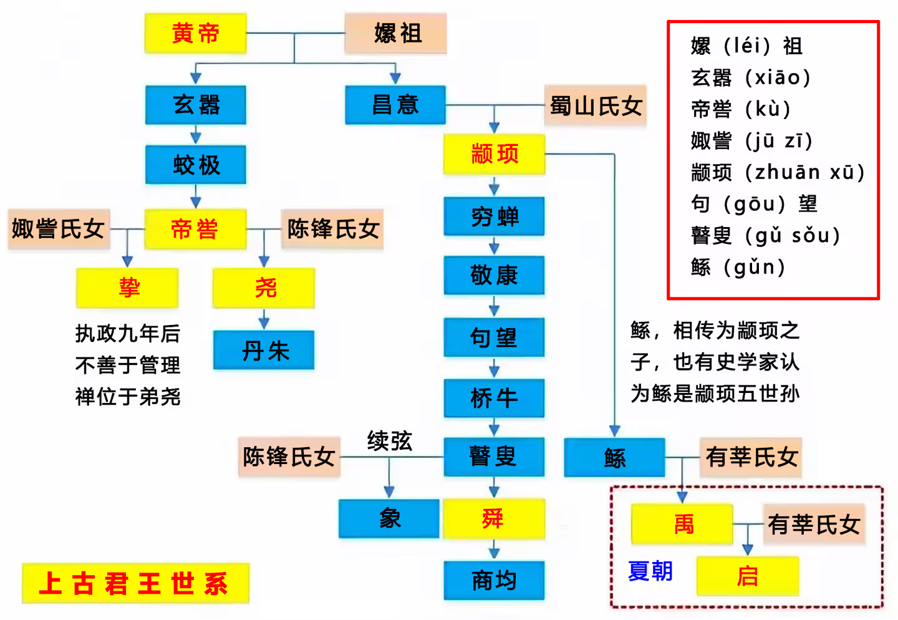
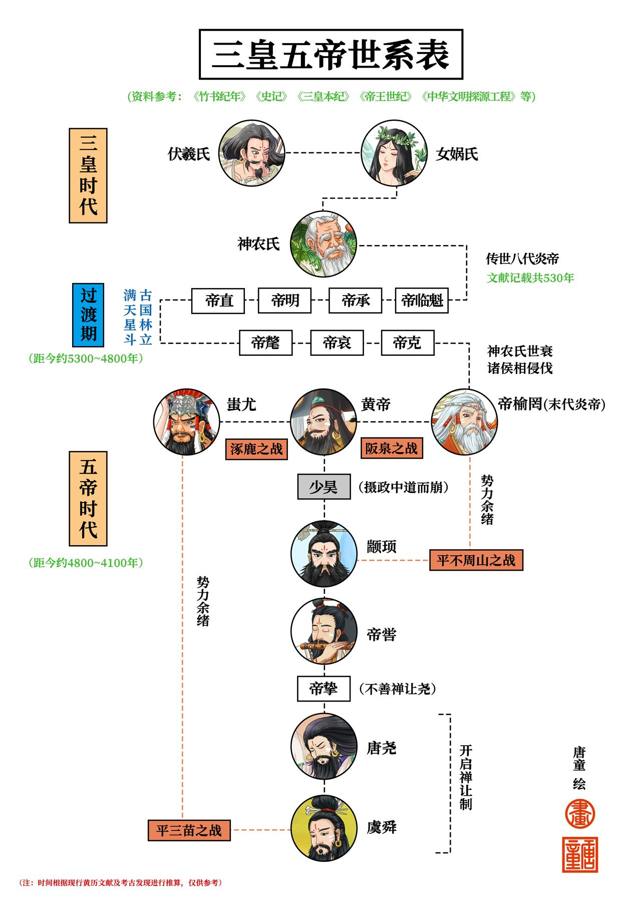

各个史书说的都不太一致（众说纷纭）。

> [!quote]
>
> 说实在话，中国人自己都是蒙圈的，没人能说清楚三皇五帝都是谁……

三皇：通常指伏羲、女娲、神农（另有天皇、地皇、人皇等说法）。
五帝：黄帝、颛顼、帝喾、尧、舜（出自《史记·五帝本纪》）。

[中国简史——三皇五帝](https://zhuanlan.zhihu.com/p/538553638)

---

尧舜禹 禅让制 大禹治水

---

# 夏

鲧->禹->启（夏朝建立者），世袭制开始，家天下。

禹逝，伯益继承，但`启`登王。

甘之战 启胜利。
巩固政权。
长子`夏太康`继承 不理政事。
东夷部族有穷氏首领后羿夺取夏朝政权 “太康失国”。
后羿未自立为王 扶`仲康`（太康弟）为王，暗地把控朝政。
仲康反对失败。
`后羿`驱逐夏`相`，即位国君 “后羿代夏” 不善国政，终日狩猎，废忠臣，重用被伯明氏驱逐的不孝子弟寒浞。
`寒浞`把控实权，夺后羿妻，霸权，国号为寒，轻徭薄赋，国力强盛。
寒军破帝丘，夏朝亡国。

相的妻子缗当时已怀下相的儿子，她从墙洞逃走至其母亲有仍氏家里避难，不久生下遗腹子少康。

`夏少康`击败寒浞，夏由此复国，建都纶城，“少康中兴”。

少康子`杼`（也作“予”）承后位，发展武器和制造兵甲，“杼作甲”、“杼作矛”。
夏朝的版图在杼的统治下扩张到了东海（黄海）之滨。杼在位期间是夏朝最昌盛的时期。

杼子`槐`在位时，东夷族与华夏族开始和平共处。九夷（九个部落）通常向夏后纳贡祝贺。

槐子`芒`继位 东夷族与华夏族逐渐同化。
芒子`泄`继位 东夷族已基本同化 对顺从夏室的方国部落封土封号。
泄子`不降`继位 多次率兵征讨西方的九苑。
不降弟`扃`继位。
扃死，其子`廑`继位。
廑继位后不久便病死，其堂兄不降之子`孔甲`继位 《史记·夏本纪》记述道孔甲“好方鬼神，事淫乱”。

---

孔甲死，其子`皋`继位。
皋死，其子`发`继位 方国部落与夏室的关系恶化，氏族内部的纠纷也激烈化。从孔甲经皋与发，到履癸（即桀）内乱不止。

孔甲乱政后夏王朝的统治日益衰落。发死后，其子`履癸`（夏桀）继位。

桀在位期间，夏室与方国部落的关系已经破裂 <u>桀是暴君</u>。

商部族首领`汤`率领着方国部落讨伐桀 “整兵鸣条，困夏南巢，谯以其过，放之历山”。

鸣条之战夏室覆灭，在方国部落的支持下，`商汤`在亳称“王”。中国历史上第一个世袭制政权夏朝，约公元前2070年建立，公元前1600年灭亡，共传13世、17王。

- [夏朝（中国历史朝代）](https://zhuanlan.zhihu.com/p/569482421)
- [11分钟看完夏朝历史](https://www.bilibili.com/video/BV1oKWM6CECJ/)

---

# 商

约公元前1600年—约公元前1046年

由成汤灭夏建立商朝，再到武王伐纣商朝灭亡。

[简述历史-商朝](https://zhuanlan.zhihu.com/p/387947063)

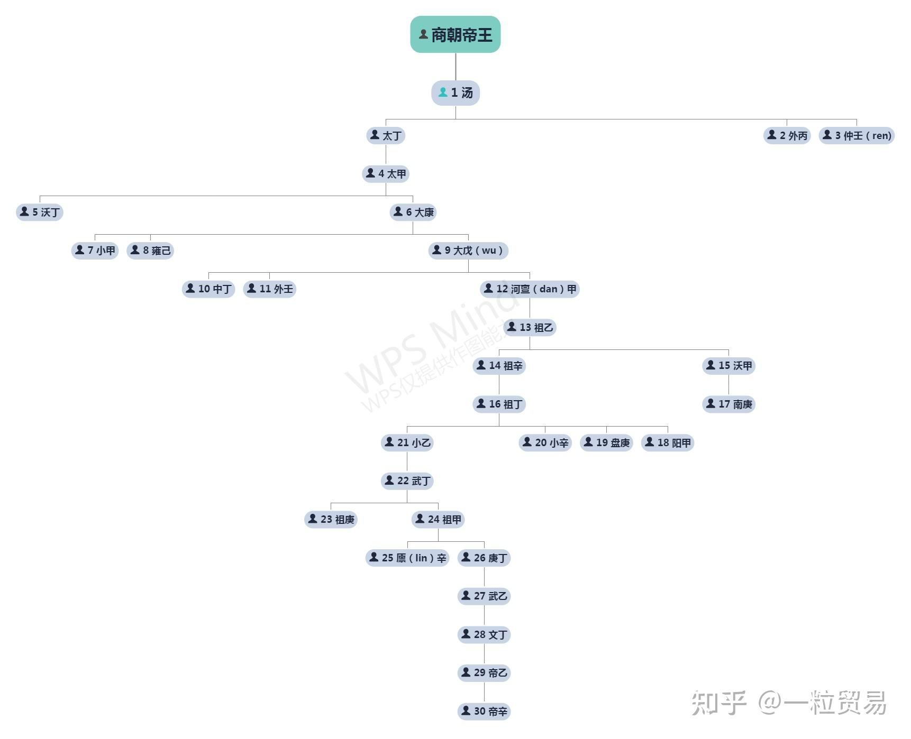

---

商汤灭夏，建立商朝。

汤子`外丙`继位。

外丙死后其弟`仲壬`继位。

仲壬死，传位长兄太丁子`太甲`。

太甲继位之初，由四朝元老伊尹辅政。

太甲任意地发号施令，一味享乐，暴虐百姓，朝政昏乱，又破坏汤制定的法规，伊尹放逐他到商汤墓地附近的桐宫 “伊尹放太甲”，`伊尹`摄政。

太甲桐宫三年，归亳，重新当政。

太甲之子`沃丁`，辅政功臣伊尹去世，沃丁以天子之礼将伊尹葬于亳都附近，亲自临丧三年。宽民的政策，发扬祖制，以德治商，笃行汤法。

沃丁死，弟`太庚`继位，太庚在位期间，履行商汤的治国之道，是商朝的一代名君。

太庚死后其子`小甲`继位。

小甲死后其弟`雍己`继位，昏庸无能，荒废政事，导致商朝衰落，各诸侯的势力日趋膨胀，以致很多诸侯故意不来朝贡。

雍己死后其弟`太戊`即位，在位七十五年，是商朝在位时间最长的一位君主。勤政修德，治国抚民，使得开始衰败的商朝再度得以兴盛，各诸侯纷纷归顺，太戊与太甲、祖乙并称三示（即三位有贡献的君主）。

太戊之子`仲丁`继位，将都城从亳（今河南商丘谷熟镇西南）西迁到嚣（今河南省郑州市），仲丁死，兄弟们凭借自己的武装力量争夺他留下的王位，造成九世之乱，商朝一度中衰。

`外壬`，外壬在仲丁死后，依靠武力成功地夺取王位，但又怕自己手握重兵的兄弟联合起来推翻他的统治，只好向自己的兄弟妥协，说我死后由你们继承王位，这就造成了商王朝继承上的混乱，史称“九世之乱”，商王室的衰落。

商王太戊之子，商王仲丁和外壬的弟弟`河亶甲`继位，迁都到于相，对商朝的稳定做出贡献，为复兴打下基础。

河亶甲之子`祖乙`，都城从相（今河南省内黄县）迁**耿**（今山西省河津市）。次年，又从耿迁到**邢**（今河北省邢台市）。后因邢发生洪水，于是再次迁都于**庇**（即沙丘平台，今河北省邢台市广宗县北大平台）。

祖乙之子`祖辛`，仍处于九世之乱，内乱使商朝再次衰落。

祖辛之弟`沃甲`继位。

祖辛之子`祖丁`继位。

沃甲之子、祖丁堂弟`南庚`继位。

祖丁之子`阳甲`继位，定都于奄，商朝内乱不止，诸侯不朝。阳甲已无法控制局面。

祖丁之子，阳甲之弟`盘庚`继位，**盘庚迁殷**后，整顿商朝的政治，遵循商汤的德政，发展经济，使衰落的商朝出现复兴的局面，所以诸侯都来朝见盘庚。

盘庚之弟，祖丁之子`小辛`继位。

祖丁之子，小辛之弟`小乙`继位，为中兴打好基础。

盘庚之侄，小乙之子`武丁`，商朝中兴。

武丁中兴

武丁对周边方国、部族的战争，拓展商朝版图和势力范围，促进中原地区与周边部族的经济、文化交流，使商朝成为西起甘肃，东至海滨，北及大漠，南逾江、汉流域，包含众多部族的泱泱大国，史称“武丁中兴”。

武丁次子`祖庚`，在他统治的数年间，商代的经济文化和国力都十分强盛，而**后母戊鼎**是他（一说是祖甲）为其母制作的鼎，故为孝心。

武丁之子，祖庚之弟`祖甲`继位。

祖甲之子`廪辛`继位。

祖甲之子，廪辛之弟`庚丁`继位。

庚丁之子`武乙`继位，商朝国势已经逐渐衰落，武乙南北征伐，战死。

武乙之子`文丁`继位，为了解除周人的威胁，采取怀柔政策，周侯季历战功赫赫，文丁下命囚禁季历，并杀了他，使得商周关系恶化。

文丁之子`帝乙`继位，商朝国势已趋于没落，东方的夷人各部趋于强盛，不断侵袭商朝统治地区，严重威胁商朝的后方。

`帝辛`，子姓，名受，商朝末代君主，世称“纣”、“商纣王”等。在传统史学叙述中，帝辛沉湎酒色、穷兵黩武、重刑厚敛、拒谏饰非，是与夏桀并称“桀纣”的典型暴君，终致众叛亲离、身死国灭，相关典故有酒池肉林、炮烙之刑、牝鸡司晨等。

**牧野之战**时，商军被周武王所率诸侯联军击败，帝辛身死，商朝灭亡 “周武王灭商”。

一位有争议的暴君

> [!quote]
> 伟人毛泽东这样点评过帝辛：把纣王、秦始皇、曹操看作坏人是错误的，其实纣王是个很有本事、能文能武的人。他经营东南，把东夷和中原的统一巩固起来，在历史上是有功的。纣王伐徐州之夷，打了胜仗，但损失很大，俘虏太多，消化不了，周武王乘虚进攻，大批俘虏倒戈，结果使商朝亡了国。商纣王是很有本领的人，但周武王把他说得很坏，主要是他的俘虏政策做得不大好，所以以后失败了。

# 周

《封神榜》

中国政治与文化变革，莫剧于殷周之际——王国维。

周王朝作为历史上第三个奴隶制王朝，自公元前1046年武王姬发带领八百诸侯打败荒淫无道的商纣王建立周朝，至公元前256年秦灭西周国，共历时790年，是中国历史上最长的朝代。在这790年里，周朝一共有32代37人继承了王位。

在这790年里，周王朝又被分为**西周**和**东周**两个社会阶段，西周建都镐京，到公元前771年结束。第二年，周平王东迁洛邑，开启了东周的历史。而东周又被划分为春秋和战国两个时期，而**百家争鸣、霸主体系、儒法帝制**都是这个社会阶段产生的。可以说，整个周王朝在中国历史上不仅塑造了封建社会的基本格局，奠定了中华文明的基调，还对后世的文化、政治、思想等方面产生了深刻影响，在中国历史上具有不可磨灭的地位。

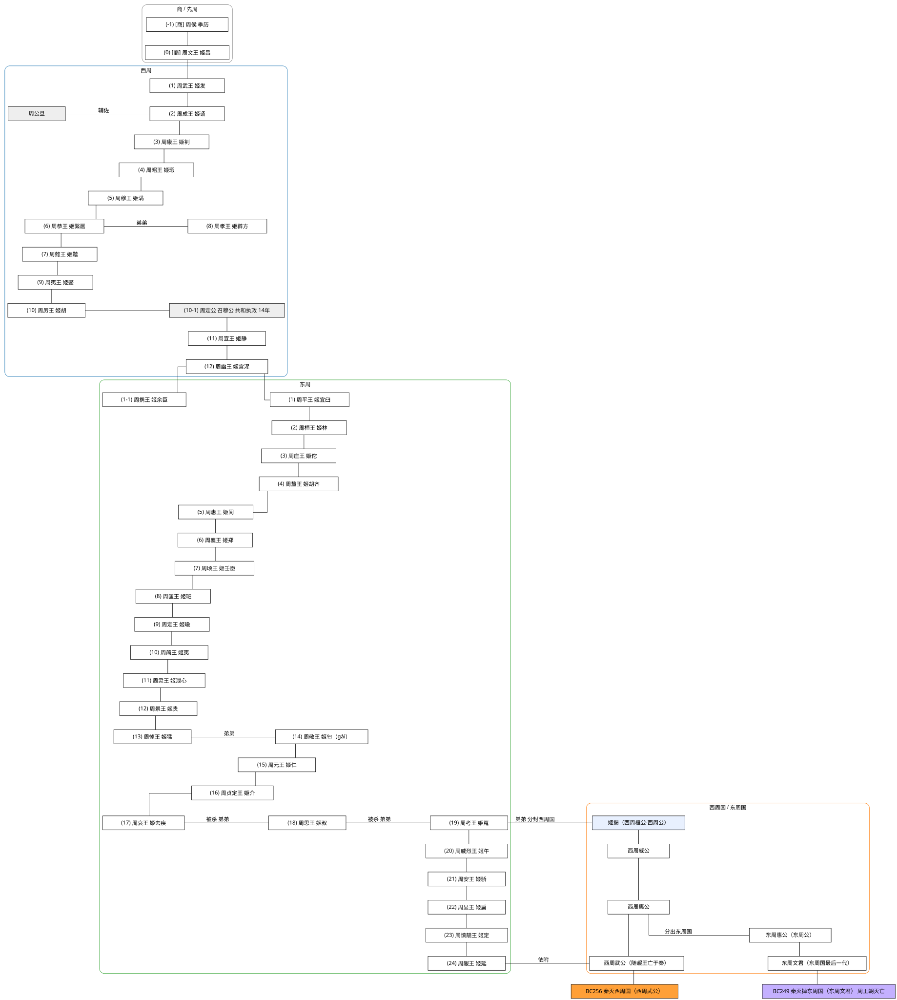

[一口气了解周朝](https://zhuanlan.zhihu.com/p/4032534507)

---

## 西周

西周始于公元前1046年，终于公元前771年，共传12王（武王至幽王；文王为追尊）。

文王`姬昌`：周文王、封神榜中的西伯侯

凤鸣岐山

据《国语》和《今本竹书纪年》记载，周文王即位后，有成群的凤凰飞来，翱翔在岐山上空鸣叫不止，这就是古人盛称的“凤鸣岐山”的典故。

姬昌与文丁、帝辛

`姬昌`的父亲季历是被商王文丁害死的，但是姬昌依然谨守臣节，接管岐邑后整修内政，迅速成长，到商纣王即位。纣王即位之初，为了笼络西、北、南三方的强藩，把姬昌、鬼侯、鄂候封为三公，避免东征时后院起火。

纣王杀鬼侯、鄂候（可参见开始的链接），拘禁西伯侯姬昌在殷墟南边约十里的羑里城。

《帝王世纪》中说，纣王拘禁姬昌后，姬昌的长子伯邑考来求纣王释放人质。结果纣王把伯邑考烹了，做成肉饼赐给了姬昌。纣王见姬昌吃了肉饼十分高兴，他觉得姬昌也并非未卜先知，连吃的肉饼是什么馅都推算不出来，觉得他威胁不了大商朝的天下，在得到了西歧进贡的财宝和美女后顺水推舟把姬昌放了。

> 所以纣王真的非常暴虐。

礼贤下士，有姜子牙等名臣辅佐，为其儿子武王伐纣打下了坚实的基础。

姬昌去世后，武王`姬发`即位，他继续任用文王选拔的原班人马，保持了政策的可持续性。

`姬发`大举伐商，决战于牧野，大败商军后，纣王自焚，商朝灭亡。

建都于镐京，史称西周，姬发分封诸侯，奠定了后世分封制的雏形。

利用**宗法制、井田制、礼乐制**来控制着国家，这三项制度影响了中国社会几千年。

宗法制、井田制、礼乐制

在宗法制度方面，确定了作为**嫡长子对家族继承的合法性**，避免了因为子嗣过多导致的争权夺位之战。

井田制就是在法理上土地是属于周王的，但是通过层层分封，底层的百姓获得了土地的使用权，**百姓在使用这些土地的时候还要向国王交纳贡赋**。

礼乐制就是**通宗法制对人进行等级划分**，家族中辈分低的人见到辈分高的人要行礼，并在大事上要听从辈分高的人指挥，然后又通过音乐来丰富人们的生活，从精神上促进人们的交流，化解因为等级化和秩序化制造的矛盾。

周武王子`姬诵`继位，史称`周成王`，没有什么大的作为，建立了新的都城洛邑。皇叔**周公旦**的辅佐（取缔了商朝的人祭风俗，并消除了关于人祭的文字记录和历史记忆，还主持创始了礼治文明）。

制礼作乐，就是创立两大制度，国家权力制度与意识形态制度。后世将周公开创的这套文明形态，称为礼治文明。

周公还创建了系统的国家官制，奠定了**后世历朝历代国家官员管理体系的雏形**，体现了**周王朝史无前例的政治创造力**。

周康王`姬钊`，25年，奉行周武王的政策，政治清廉、国家安定，路不拾遗、夜不闭户，与他父亲周成王时期合称为**成康之治**。

周昭王`姬瑕`，天下开始礼崩乐坏。

周穆王`姬满`，是西周在位时间最长的君主，55年，作《吕刑》一书，是流传下来的我国最早的法典。巩固内部统治，拓疆土。

周恭王`姬繄扈`，穆王子，采取怀柔政策，不再对外发动战争，并且实行**土地私有制**，只要**缴纳税金土地就可以交易**，土地从此不再是属于周王室的了。周恭王将属于周王室的土地分封出去后，周王室的土地越来越少，能供周王室支配的百姓也越来越少，周王室的衰落也从此开始。

周懿王`姬囏`是周恭王的儿子，不思进取，政治腐败，对内地的纵容和对外的不抵抗政策，让周王朝进一步的衰落。

周孝王`姬辟方`是周懿王的叔父，周恭王的弟弟（非法获得的王位），抢周懿王子姬燮的。

周孝王死后，周夷王`姬燮`在诸侯的拥立下又重新继承了王位，天下的异姓诸侯已经不再去朝贡周天子，周天子与诸侯的矛盾也日益尖锐。

周厉王`姬胡`是周夷王姬燮之子，积重难返，改革，实行了非常严厉的法家制度，激起了大量民众的反叛，**“防民之口甚于防川”** 的典故来源于这位暴君。

周召共和，周、召共和是指`周定公`与`召穆公`共同执政。此二人均为宗周的大贵族，执政14年。

周宣王`姬静`，改革成功，**宣王中兴**，战争失败，再次衰落。

周幽王`姬宫湦`，**烽火戏诸侯**，昏君，众叛亲离的周幽王最后被犬戎杀死于骊山下。

---

一个百家争鸣、儒法帝制初形成的社会阶段

## 东周

BC 770，周幽王太子`宜臼`由镐京迁都于洛邑，史称东迁后之周王朝为东周。

直至周赧王59年（前256年），秦灭西周国，周赧王卒，周朝终结，共传25王，历时515年。

[`周平王`](https://baike.weixin.qq.com/v10008650489.htm)迁都后成为了东周的第一任君王。

`周桓王`，周王室形同虚设，郑庄公成为了春秋时期第一个称霸的诸侯。

`周庄王`姬佗，笼络齐国。

`周釐王`姬胡齐在位期间，齐国的齐桓公在管仲辅佐之下，将齐国治理得国富兵强。为了借助周王的名义争霸天下，齐桓公接受管仲的建议，提出“尊王攘夷” 的口号，表示要尊奉周天子，抵御少数民族对中原地区的攻掠，并马上派使臣向周釐王朝贺。

`周惠王`姬阆

`周襄王`姬郑即位，东周正式进入**五霸时期**。

五霸

历史上对春秋五霸的记载并不统一，主要有两种代表性说法：

《史记·索隐》版本：齐桓公、宋襄公、晋文公、秦穆公、楚庄王
《荀子·王霸》版本：齐桓公、晋文公、楚庄王、吴王阖闾、越王勾践
学术界普遍认为齐桓公和晋文公是五霸中最具代表性的两位，其余人物因史书不同而有所差异。民国及现代教科书多采用《史记》或《荀子》的版本。

`周顷王`姬壬臣，向鲁国讨钱安葬襄王。

`周匡王`姬班，晋灵公——赵盾事件。

`周定王`姬瑜，易子而食，诸侯争霸是以百姓的生命和生活为代价的。

`周简王`姬夷即位，周天子权威已荡然无存，除了晋、楚、秦、宋、郑等国相互攻伐不止以外，位于东南地区的吴国兴起，屡次攻入楚国，卷入了**春秋混战**的行列。

`周灵王`姬泄心，“弭兵会盟”：约定各国间停止战争，奉晋、楚两国为共同霸主，平分霸权，谁破坏协议，各国共讨。

弭兵会盟

成为了春秋时期两个阶段的分水岭，会盟以前以诸侯国之间的兼并为主，会盟以后却以各国内部大夫间的兼并为主，各国社会正酝酿着巨大的变化，阶级矛盾趋于尖锐。

`周景王`姬贵，**[数典忘祖](https://baike.baidu.com/item/%E6%95%B0%E5%85%B8%E5%BF%98%E7%A5%96/2022670)**，周景王铸造了大钱，是我国文献中关于铸钱的最早纪录。

`周悼王`姬猛

周悼王姬猛去世后，其弟周敬王即位。`周敬王`姬匄（gài）继位后，和西王姬朝长期相互攻伐，争夺帝位。六年后，他在晋兵帮助下，击败姬朝，巩固了王位。

周敬王经历了吴越争霸，也见证了**孔儒思想**的形成。

孔子

姬匄在位期间，孔子度过了他忙碌的中年和晚年。他提出了一套维护正在崩溃的奴隶制度的政治主张和理论根据。他的保守思想后来被封建统治者加以改造和利用，成为维护封建制度和统治人民的精神工具。孔子兴办私学，扩大教育对象，在教育思想和教学方法上也积累了不少有益的经验，并在晚年编订了古代文化典籍《诗经》、《尚书》、《春秋》，为保存和发展我国古代文化遗产作出了重要贡献。

`周元王`姬仁，是春秋、战国的分界线，越王勾践灭吴，勾践成为霸主。

`周贞定王`姬介，三家分晋（即晋国的三家大夫赵襄子、韩康子、魏桓子共同攻灭最后一家贵族智伯，形成了三个国家赵国、韩国、魏国）。

`周哀王`姬去疾，在位三个月，被弟弟姬叔所杀；`周思王`姬叔即位五个月被另一个弟弟姬嵬杀死；`周考王`姬嵬，王城封给了小弟弟姬揭。

`周威烈王`姬午，《资治通鉴》从周威烈王二十三年开始写起。

三家分晋合法

在司马光看来，发生了一件大事，即周威烈王姬午任命晋国大夫魏斯、赵籍、韩虔为诸侯。这一承认不打紧，使原本属于打家劫舍的三家分晋，变成合法的了。司马光由此写了一篇长达1200多字的评论，认为周天子此举是周室益发破落的关键。

`周安王`姬骄继位，田氏代齐。

`周烈王`姬喜

`周显王`姬扁，商鞅变法。

齐国与魏国两次著名战役

一次史称“桂陵之战”，成语“**围魏救赵**”就出自此次战役。另一次史称“马陵之战”，是成语“**增兵减灶**”的出处。

`周慎靓王`姬定，**合纵连横**，纵横家。

`周赧王`姬延，西周的地盘被秦国吞并，九鼎也落到了秦王的手里，大周王朝走向了灭亡。

长平之战后，各诸侯国向周王室求救，希望以周天子名义共同讨伐秦国。这位周赧王还以为机会来了，由周天子集结的讨伐大军以失败告终，却招来了秦国的报复，很快，秦国大军就直扑周王城，周天子被打的落花流水。

BC249，秦庄襄王灭掉东周公。东、西两周就全都归属于秦国，周王朝的祭祀从此断绝，正式退出历史舞台。

---

# 秦

BC221-BC207

大一统王朝

开国君主秦王`嬴政`自称始皇帝，首创皇帝这一词语。

首创了**皇帝制度**、以**三公九卿**为代表的中央官制，以及**郡县制**。

秦孝公，秦惠文王，秦昭襄王，秦王政

商鞅，张仪，吕不韦，李斯，尉缭，赵高

白起，王翦，李信，蒙恬，章邯

嬴政-胡亥-子婴

- [秦朝时期历史事件大全](https://zhuanlan.zhihu.com/p/649547760)
- [秦朝：大一统帝国的崛起与落幕](https://zhuanlan.zhihu.com/p/28752214852)

---

**秦灭六国之战**

BC230-BC221 10年 相继灭掉了北方的燕、赵，中原的韩、魏，东方的齐和南方的楚六个国家。

**荆轲刺秦王**

BC227，风萧萧兮易水寒，壮士一去兮不复还。

> [!quote]
> 秦将王翦破赵，虏赵王，尽收其地，进兵北略地，至燕南界。
> ...

---

统一度量衡，书同文，车同轨，郡县制，焚书坑儒。

阿房宫，骊山陵（秦始皇陵）

北击匈奴：蒙恬。

万里长城

秦始皇巡游，5次，在西返咸阳途中于沙丘(今河北邢台附近)病逝。

**沙丘之变**

始皇于沙丘暴卒，宦官赵高胁迫左相李斯发动“沙丘之变”，他们合谋篡改了始皇的传位诏书，废太子扶苏，改立胡亥为新帝，为秦二世。

---

赵高专政。

废绝卫祀。

**大泽乡起义**

陈胜吴广起义，是中国历史上第一次大规模的平民起义，连克大泽乡和蕲县，并在陈县(今河南淮阳)建立张楚政权，各地纷纷响应。陈胜得势后骄傲，加上秦将章邯率秦军镇压而失利。

**秦末农民战争**

陈胜、吴广领导的大泽乡起义，其后各地响应，其中属**项羽**和**刘邦**领导的两支军力最强。推翻了秦朝，打击了地主阶级。

**巨鹿之战**

巨鹿之战，是秦末大起义中，项羽率领数万楚军(后期各诸侯义军也参战)，同秦将章邯、王离所率40余万秦军主力在巨鹿(今河北平乡)进行的一场重大决战性战役，也是中国历史上著名的以少胜多的战役之一。项羽**破釜沉舟**，以大无畏精神在各诸侯军畏缩不进时率先猛攻秦军，带动诸侯义军一起最终全歼王离军，并于数月后迫使另20万章邯秦军投降。从此项羽确立了在各路义军中的领导地位。经此一战，秦朝主力尽丧，名存实亡。

项羽击破秦朝主力。

---

望夷宫之变

**刘邦废除暴政**

约法三章。

BC207，`刘邦`占领秦都咸阳后，废除了秦的苛法严刑，“杀人者死、伤人及盗抵罪”。

刘邦率领的起义军率先进入关中，秦王子婴向刘邦投降，秦朝灭亡 。

**项羽焚宫**

项羽烧阿房宫。

---

# 汉

BC 202—AD 220

汉朝是中国历史上继秦朝之后的大一统王朝，分为西汉和东汉两个时期，共历29帝，统治中国长达405年。

汉朝以“强汉”之名载入史册，其政治整合、文化融合与技术创新，塑造了此后两千年中华文明的基本格局，被誉为“国恒以弱灭，独汉以强亡”的传奇王朝。

1. 政治架构

   三公九卿制（丞相→尚书台）
   察举制（孝廉、茂才、贤良方正）
   《九章律》到《汉律六十篇》的演进

2. 经济体系

   代田法（赵过发明）
   水排鼓风冶铁（杜诗发明）
   丝绸之路贸易

3. 科技成就

   张衡地动仪（候风地动仪）
   《周髀算经》勾股定理
   《氾胜之书》农业技术
   蔡伦改进造纸术（105年）

4. 文化瑰宝

   司马迁《史记》（纪传体开山）
   班固《汉书》首创断代史
   汉赋四大家（司马相如、扬雄、班固、张衡）
   乐府诗（《孔雀东南飞》）

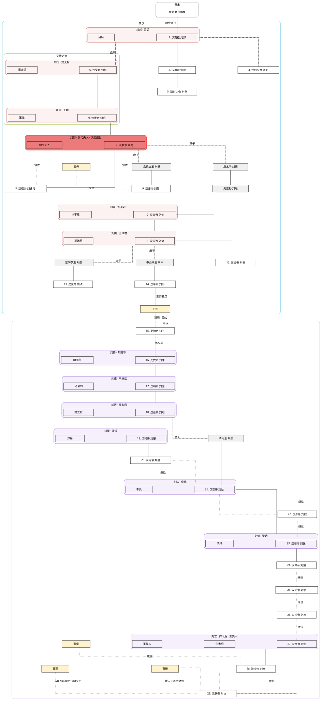

- [汉朝时期历史事件大全](https://zhuanlan.zhihu.com/p/649547814)
- [汉朝历代皇帝：共29位皇帝(开国皇帝为汉太祖刘邦)](https://zhuanlan.zhihu.com/p/645787271)
- [汉朝历史全景：从布衣天子到豪强末世（前202年-220年）](https://zhuanlan.zhihu.com/p/26159540447)
- [汉朝皇帝年表](https://zhuanlan.zhihu.com/p/30898138651)

---

大泽乡起义-秦末农民战争-巨鹿之战-约法三章-鸿门宴-[暗渡陈仓](https://www.hanyuguoxue.com/chengyu/ci-8451fb7e3)-楚汉之争（成皋之战、垓下之战）

章邯、陈胜、项羽、刘邦、王离、范增、韩信、陈馀、张良、英布

---

## 西汉

1. 汉高祖刘邦，在楚汉战争中击败项羽后称帝，建立汉朝，定都长安，实行休养生息政策，对匈奴采取和亲政策，奠定了汉朝的基本政治格局。

1. 汉惠帝刘盈，继续推行休养生息政策，与匈奴和亲，废除挟书律。实际朝政由母吕后把持。

1. 汉前少帝刘恭，在位期间朝政由吕后把持（吕后临朝称制时被拥立为帝，后被吕后囚禁并废黜）。

1. 汉后少帝刘弘，在位期间朝政由吕后把持（吕后临朝称制时被拥立为帝，吕后死后被诛杀）。

1. 汉文帝刘恒，勤俭治国，废连坐和肉刑，“文景之治”。

1. 汉景帝刘启，平七国之乱，休养生息，西汉走向强盛，“文景之治”。

1. 汉武帝刘彻，政治、军事、文化等多方面成就卓越，“汉武盛世”，伐匈奴，拓疆域。

    

    
汉武盛世

   政治：推恩令瓦解诸侯，设立十三州刺史

   经济：盐铁官营、均输平准、发行五铢钱

   军事：卫青霍去病北击匈奴，设河西四郡

   文化：董仲舒"罢黜百家，独尊儒术"

   外交：张骞凿空西域，开辟丝绸之路

    

1. 汉昭帝刘弗陵，在霍光辅佐下，继续休养生息政策，与匈奴和亲。

1. 汉废帝刘贺，被霍光拥立为帝，后又因不符合皇帝规范被霍光废黜（27天）。

1. 汉宣帝刘询，霍光拥立为帝，初期由霍光辅政，霍光死后亲政。打击地方豪强，设立常平仓，降服西域，开创“汉宣中兴”。

   

   
昭宣中兴

   召开盐铁会议（桓宽《盐铁论》）

   设置西域都护府（郑吉首任都护）

   匈奴呼韩邪单于归附，昭君出塞

   

1. 汉元帝刘奭，宠信宦官，导致皇权衰落，但用王昭君和亲匈奴。

1. 汉成帝刘骜，朝政腐败，外戚崛起。

1. 汉哀帝刘欣，改元“建平”，外戚王氏势力进一步扩大。

1. 汉平帝刘衎，王莽专权，最终禅位于王莽，西汉灭亡。

   

   
王莽篡汉

   推行王田制（土地国有化）

   实施五均六筦（全面经济管制）

   发行二十八种新货币

   改名癖（长安改常安，匈奴改恭奴）

   绿林赤眉起义终结其统治

   

## 东汉

1. 更始帝刘玄，建立更始政权，但最终在赤眉军和刘秀大军夹击下灭亡。

1. 光武帝刘秀，建立东汉王朝，实行休养生息政策，使国家出现“光武中兴”。

1. 汉明帝刘庄，实行严格统治，击败匈奴，恢复西域都护府，开创“明章之治”。

1. 汉章帝刘炟，休养生息，平定诸蛮夷和西域，使东汉走向强盛。

1. 汉和帝刘肇，联合宦官夺回政权，对内休养生息，对外击败少数民族，开创“汉和盛世”。

1. 汉殇帝刘隆，在位仅7个月，一岁时夭折。

1. 汉安帝刘祜，初期由邓绥临朝听政，邓绥死后亲政。

1. 汉少帝刘懿，在位仅8个月，由阎显兄弟把持朝政。

1. 汉顺帝刘保，被宦官拥立为帝，后将大权交给宦官，导致梁氏专权。
1. 汉冲帝刘炳，在位仅1年，由梁妠临朝听政，外戚梁冀飞扬跋扈，实际朝政由梁氏家族掌控。
1. 汉质帝刘缵，在位仅1年，由梁冀拥立，后被梁冀毒死，实际朝政由梁冀把持。

1. 汉桓帝刘志，宦官势力发展，党锢之祸发生。初期由梁妠临朝听政，后依靠宦官翦除梁冀，宦官乱政开始。

1. 汉灵帝刘宏，宦官势力达到顶点，军阀割据局面形成，东汉衰亡无力回天。

1. 汉少帝刘辩，在位仅4个月，后被董卓废黜。

1. 汉献帝刘协，被董卓、曹操等控制，最终禅位于曹丕，东汉灭亡。

---

# 三国

三国的历史不太好找，搜索全是《三国演义》，文学创作非常多，而我对三国的了解也是模棱两可。

[一口气看完三国历史](https://www.bilibili.com/video/BV1WqXrB9EK8/)

**政治架构**

1. **东汉旧底子的崩坏**
   东汉原本是三公 + 州郡县，后期刺史从监察官变成军政长官；黄巾之后朝廷失去对地方控制，**豪强士族、军阀割据**成为常态。
2. **曹魏**

- 中央：设尚书台，尚书令实权上升，三公慢慢变成荣誉高位，皇权逐步向尚书台集中，是后世三省制的源头。
- 选官：**九品中正制**（曹丕推行）：由中正官品评士人，分品级授官。初期兼顾才干家世，后期逐渐演变成 “上品无寒门，下品无势族”，士族垄断仕途。
- 地方：州、郡、县；另外设置都督，掌战区兵权，都督制度对魏晋影响很大。

1. **蜀汉**

- 体制大体沿用汉制，丞相权力很重（诸葛亮时期）；诸葛亮死后不再设丞相。
- 以荆州集团为核心，拉拢益州本土士族，治理偏严，法度整齐；疆域最小，行政体系精简。

1. **孙吴**

- 同样汉制框架，非常依赖江东本土大族（顾、陆、朱、张），士族和政权深度绑定；实行**世袭领兵制**，大族有私人部曲，私兵合法化，地方豪强势力很强。

1. **西晋**

- 继承曹魏制度，尚书台为行政核心；九品中正制完全向士族倾斜。
- 重大变化：**大封宗室诸王**，诸王有封地、兵马、财权，司马炎想靠宗室保卫皇室，直接埋下后来八王之乱的祸根。

> 核心特点：从军阀临时体制，慢慢定型为**士族门阀主导的政治**，九品中正制是这个时代最标志性的制度。

**经济体系**

整体背景：汉末大战乱，人口锐减、大片土地荒芜，粮食是第一要务，三国都围绕 “屯田” 来恢复生产。

1. **曹魏（北方）**
   最成熟：**屯田制**，分军屯、民屯。官府提供土地、耕牛，流民 / 士兵耕种，收成和官府分成。快速恢复北方农业，支撑长期战争。后期屯田慢慢衰败，土地被豪强兼并。

- 水利：修芍陂、茹陂等陂塘灌溉工程；北方重新恢复桑蚕业。

1. **蜀汉（益州）**
   益州本来天府之国，底子好。重视农田水利，维护都江堰；
   特色产业：**蜀锦**，是国家重要财政来源，蜀锦远销魏吴；盐铁官营，控制井盐、铁矿。国土小、人口少，经济承载力弱，长期北伐消耗国力。
2. **孙吴（江南）**
   大力开发长江以南，北方流民南下带来先进耕作技术；推广牛耕。

- 手工业：造船业极强，能造大型海船；海路商贸发达，和交趾（越南北部）、南洋有往来。
- 庄园经济兴盛，江东大族的庄园自给自足，占有大量土地、依附人口。

1. **西晋统一后**
   颁布**占田制**，规定农民、官员可以占有土地的限额，试图限制兼并、鼓励垦荒。但约束无力，士族豪强疯狂占田、藏匿依附人口，土地兼并愈演愈烈。

小结：这一时期是**江南开发的起步阶段**，经济重心还在北方，但南方经济第一次得到大规模开发。

**科技成就**

1. **机械与天文（曹魏）**
   马钧：当世顶尖发明家。改良织绫机；**发明翻车（龙骨水车）**，用于农田灌溉；制造指南车、水转百戏。
2. **历法数学**
   刘徽（曹魏 — 西晋）：《九章算术注》，提出**割圆术**，算圆周率，是中国古代数学里程碑。
3. **医学**
   华佗：汉末，擅长外科，传说有麻沸散（麻醉），提倡五禽戏养生；
   张仲景：《伤寒杂病论》，汉末成书，奠定中医辨证论治体系（张仲景主要是东汉末，跨这个阶段）。
4. **地理**
   裴秀（西晋）：**《禹贡地域图》**，提出 “制图六体”，也就是古代地图绘制六大原则，是中国地图学奠基理论。
5. **其他**
   冶铁技术进步；孙吴造船技术代表当时世界一流水平；蜀汉井盐开采技术成熟。

**文化瑰宝**

1. **玄学兴起（魏晋标志性文化）**
   曹魏后期到西晋，玄学开始兴盛，研究《老子》《庄子》《周易》（三玄）。崇尚清谈，追求自然，和儒家经学分庭抗礼。代表人物：何晏、王弼（正始玄学）；西晋有竹林七贤。
   汉代重经学、守礼教；魏晋开始出现重个性、思辨的风气。
2. **史学**
   《三国志》（陈寿，西晋），就是我们说的正史；还有《后汉纪》等。
3. **宗教发展**
   佛教持续传入，开始在中原、江南传播，寺庙逐步增多；本土道教成型，张道陵五斗米道在汉末发展，道教组织化。
4. **书法**
   隶书向楷书、行书过渡；钟繇（曹魏）被称为楷书之祖，书法上承汉隶，下启二王。

**文学成果（建安文学为核心）**

1. **建安文学（汉末至魏前期）**
   建安风骨：风格刚健悲凉，写乱世流离、建功之志。
   代表：三曹（曹操、曹丕、曹植）、[建安七子](https://baike.baidu.com/item/%E5%BB%BA%E5%AE%89%E4%B8%83%E5%AD%90/66612)（孔融、王粲、刘桢等）
   名篇：曹操《短歌行》《观沧海》；曹丕《燕歌行》（现存最早成熟七言诗）；曹植《洛神赋》《白马篇》；王粲《七哀诗》。
2. **正始文学**
   司马氏掌权时期，代表竹林七贤（阮籍、嵇康）。诗文多隐晦，批判黑暗政局，寄寓避世思想；嵇康散文、阮籍《咏怀诗》八十二首很有名。
3. **西晋文学**
   太康文学，讲究辞藻华丽、对仗工整，代表陆机、潘岳。文采华美，但风骨偏弱。陆机《文赋》，是中国最早系统的文学理论文章之一。

**历史地位**

1. 它是**秦汉大一统，到南北朝大分裂之间的过渡时代**。四百年汉王朝终结，旧的社会秩序、经学思想崩塌，新的社会形态慢慢形成。
2. 制度层面：九品中正制、都督制、尚书台发展，塑造了魏晋南北朝数百年的士族门阀时代，一直影响到隋唐。
3. 经济上：开启江南大规模开发，为后世唐宋经济重心南移埋下伏笔。
4. 思想文化：建安文学、玄学兴起，文学、书法、思辨哲学迎来大变局；不再单纯独尊儒学，思想走向多元，是中国文化史上非常有个性的一段。
5. 负面遗产：西晋分封宗室、门阀固化，加上民族问题积累，统一短短十几年就爆发八王之乱，很快引来五胡乱华，华夏陷入更长时间的南北分裂。

---

知乎AI总结

群雄割据阶段（184年—207年）

这一阶段的主线是东汉瓦解与曹操统一北方。

- 184年：2月黄巾起义爆发，10月张角病死。凉州之乱同时爆发，董卓、曹操、孙坚、刘备均参与镇压黄巾军。
- 188年：汉灵帝设西园八校尉，宦官蹇硕居首，位在大将军何进之上；袁绍排第二，曹操排第四。
- 189年：灵帝驾崩，何进杀蹇硕，十常侍又杀何进，袁绍、袁术诛十常侍。9月董卓入京，废少帝刘辩，立九岁的陈留王刘协为献帝。
- 190年：1月各路诸侯起兵讨董，推袁绍为盟主。董卓焚洛阳、迁都长安。
- 192年：4月王允设连环计，吕布杀董卓；6月李傕、郭汜围长安杀王允。同年曹操击败青州黄巾军，收编为“青州兵”，实力大增。
- 196年：曹操迎献帝于许，开始“挟天子以令诸侯”，并始兴屯田。
- 200年：官渡之战，曹操火烧乌巢，击败袁绍，奠定北方霸权。
- 207年：曹操北征乌桓，基本统一北方。

三国鼎立阶段（208年—229年）

- 208年：赤壁之战，曹操被孙刘联军击败，奠定三国鼎立雏型。
- 220年：正月曹操死，其子曹丕继魏王位；十月曹丕称帝，国号魏，建都洛阳，三国历史正式开始。
- 221年：四月刘备在成都称帝，国号汉，史称蜀汉。
- 222年：夷陵之战刘备兵败，孙权获荆州大部。
- 229年：四月孙权在武昌称帝，国号吴；九月迁都建业，三国鼎立局面正式确立。

对峙走向统一（230年—280年）

- 249年：高平陵之变后，曹魏实权逐渐被司马懿掌控。
- 263年：司马昭发动魏灭蜀之战，蜀汉灭亡。
- 266年：司马炎迫使魏元帝禅让，建国号晋，曹魏灭亡。
- 280年：西晋灭东吴，统一全国，三国时期结束，进入晋朝。

豆包AI总结

1. **184 年 黄巾起义**
   张角兄弟发动黄巾之乱，各地州郡自行募兵平叛。朝廷放权，地方豪强、刺史郡守掌握兵权，东汉中央权威崩塌，天下大乱的开端。刘备、曹操、孙坚都是在平黄巾时起家。
2. **189 年 董卓入京**
   汉灵帝去世，外戚与宦官火并。董卓趁机带兵进入洛阳，废少帝、立献帝，把持朝政，残暴专横。关东各州郡联合起兵讨董，讨董联军松散，不久内讧，群雄割据局面正式形成。
3. **190–196 年 群雄混战**
   董卓西迁长安，后被王允、吕布诛杀；关中大乱。关东互相攻伐：袁绍占河北，袁术在淮南，曹操在兖州，刘表守荆州，刘璋据益州，孙策渡江开拓江东。**196 年，曹操迎汉献帝到许都，“挟天子以令诸侯”，获得政治优势。**
4. **200 年 官渡之战**
   曹操以少胜多击败袁绍，逐步吞并河北，成为北方最强势力。
5. **207 年 曹操平定乌桓**
   北方彻底平定。刘备此时依附刘表，三顾茅庐请出诸葛亮，定下《隆中对》：跨有荆益，联吴抗曹。
6. **208 年 赤壁之战**
   曹操南下，刘琮不战而降，荆州大部分落入曹操之手。刘备联合孙权，在赤壁大破曹军。
   此战阻止曹操一统天下，奠定三分天下的基础。战后刘备攻取荆州南部四郡。
7. **211–219 年 地盘瓜分**
   刘备入蜀，夺取益州；之后从曹操手里拿下汉中，进位汉中王。
   关羽发动襄樊之战，水淹七军，威震华夏；随后孙权偷袭荆州，吕蒙白衣渡江，关羽败走麦城被杀，孙刘联盟破裂。
8. **220 年 曹丕代汉，魏国建立**
   曹操去世，曹丕逼迫汉献帝禅位，东汉正式灭亡，定都洛阳，国号魏。
9. **221 年 刘备称帝，夷陵之战**
   刘备在成都称帝，国号汉（后世称蜀汉）。为夺回荆州、报仇，大举伐吴。**222 年夷陵之战**，陆逊火烧连营，蜀军大败，刘备退守白帝城。
10. **223 年 刘备托孤**
    刘备病逝白帝城，托孤诸葛亮辅佐刘禅。诸葛亮遣使和东吴重修联盟，孙刘再次联合抗魏。
11. **229 年 孙权称帝**
    孙权于建业称帝，国号吴。魏、蜀、吴三国鼎立格局正式成型。
12. **225–234 年 诸葛亮南征、北伐**
    诸葛亮南征孟获，平定南中后方；之后多次出兵北伐曹魏，以弱攻强，没能实现北伐大业，234 年病逝五丈原。蜀汉此后转入守势。
13. **239–249 年 魏国政局变化**
    魏明帝曹叡去世，托孤曹爽与司马懿。249 年**高平陵之变**，司马懿发动政变除掉曹爽，曹魏实权落入司马氏手中。
14. **251–264 年 司马掌权，内部清洗**
    司马懿死后，司马师、司马昭相继掌权，镇压淮南多次叛乱。263 年，司马昭派邓艾、钟会伐蜀，邓艾偷渡阴平，刘禅投降，蜀汉灭亡。
    之后钟会、姜维密谋叛乱失败被杀。
15. **265 年 西晋建立**
    司马昭去世，其子司马炎逼迫魏元帝禅位，建立晋朝（西晋），定都洛阳，曹魏灭亡。此时只剩东吴割据江南。
16. **280 年 西晋灭吴，天下一统**
    司马炎派大军南下伐吴，吴主孙皓投降。自黄巾以来近百年分裂局面结束，三分归晋。

---

# 魏晋南北朝

魏晋南北朝是中国历史上最混乱动荡的一段历史，从东汉末年一直持续到隋朝灭陈，将近400年的历史。在这近四百年的历史中，群雄四起，分裂割据，战乱不断，北治南乱，南治北乱，此起彼伏。

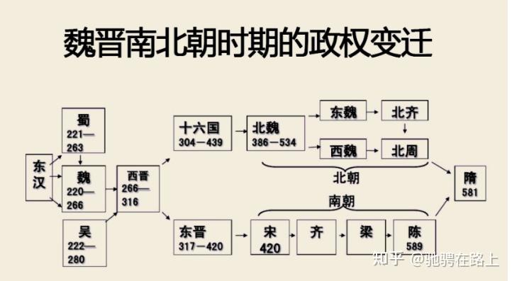

[一口气读懂魏晋南北朝，重点都列好了](https://zhuanlan.zhihu.com/p/678299686)

---

**魏**指的就是承袭了汉朝正统的魏国，这一时期是魏、蜀、吴三国时代。

**晋**指的就是西晋和东晋，西晋接受了曹魏的禅让，建立了正统王朝，西晋灭亡后，南渡的司马氏皇族建立了东晋。

**南北朝**就是南朝和北朝，南朝指的是在南方灭亡东晋，接受东晋禅位的南朝宋，和宋灭亡后建立的齐、梁、陈；北朝指的就是在北方统一了的北魏，和由北魏分裂而来的东魏、西魏、北齐、北周。

最终，近400年的魏晋南北朝历史在隋朝的建立中走向了统一，公元581年杨坚建立隋朝，公元589年，隋朝灭南朝陈，统一全国。

---

## 三国

> 我个人觉得是到曹丕称帝开始。

这时候天下还没有统一，曹魏政权是三国中势力最大的一个，因为曹魏接受了汉朝的禅位，所以在魏蜀吴三国中，曹魏是被看作正统朝廷的。

曹魏历经5位皇帝，共计46年，开国皇帝是魏文帝曹丕，公元266年，司马炎逼迫末代皇帝曹奂禅位，取代曹魏，建立了西晋。

蜀汉共经历了二帝，43年。

东吴政权历经四帝，自229年孙权称帝起共51年。

## 晋朝

AD 266-AD 420

晋朝分为西晋和东晋，以及这段时间共存的五胡十六国。

公元266年西晋建立，公元280年西晋统一全国，公元291年爆发八王之乱，公元316年西晋灭亡，北方陷入了五胡十六国，南方建立了东晋，直到420年东晋灭亡。

曹魏王室衰微，司马氏掌权，AD266，曹奂被迫禅位司马炎，西晋开始。

AD280，西晋灭吴。

分封诸王，八王之乱，外敌入侵。

AD 316 西晋被匈奴灭亡。

西晋共历经4帝，51年。

西晋可谓是历史上最孬的统一王朝，被外族所灭，这根源在于司马氏自家，司马懿司马师司马昭三代未有寸功，却坐享其成，篡夺曹魏江山。

## 五胡十六国

西晋灭亡后，北方陷入了五胡十六国的长期割据。

五胡十六国的上限是公元304年成汉政权的建立，下限是公元439年，北魏统一北方，十六个国家全部灭亡。

## 东晋

五胡十六国和东晋是共存的时代。

AD317，司马氏皇族司马睿南渡建康，重建晋朝，历史上称为东晋。

东晋时期的政治特点是门阀政治，即世家大族与司马氏共同治理天下，先后共有4大家族，分别是王、庾、桓、谢。

AD383，前秦侵东晋，败，北方乱，东晋内斗，刘裕掌权。

AD 420，刘裕接受东晋禅让，建立了南朝宋，也称刘宋，南方进入了南朝时期。

AD 439，北魏统一北方。

---

## 南北朝

420-589

- 南朝：420-589
- 北朝：439-581

南朝共有宋、齐、梁、陈四个朝代，因为宋是接受了东晋的禅让，晋朝接受曹魏的禅让，曹魏接受汉朝的禅让，所以这一时期的南朝为正统朝廷。

但是有趣的是，这时期的北朝也是正统朝廷，南朝骂北朝叫索虏，北朝骂南朝叫岛夷，双方都以中国自居，民族大融合在这一期达到了顶峰。

> 一个国家，两个政府，这不是……

公元420年，权臣刘裕逼迫东晋的末代皇帝晋恭帝司马德文禅位，刘裕建立了刘宋。

公元479年，萧道成取代刘宋，建立了南朝齐。

权臣萧衍废掉齐帝，于公元502年建立了南朝梁。

梁朝后期发生了侯景之乱，北方这一时期发生了河阴之变。北方分裂，南朝灭亡。

公元557年，权臣陈霸先废掉了梁敬帝，灭亡梁朝，建立了南朝陈。

公元589年，在北方，已经重新统一起来的隋朝南下灭亡了陈朝，南朝结束。

公元439年，北魏太武帝拓跋焘先后吞并其他国家，北方再次统一，北魏开启了北朝时代。

北魏孝文帝汉化改革之后，北魏迁都到洛阳，越来越以正统王朝自居。

> 北魏历史复杂，参见：[一口气读懂魏晋南北朝，重点都列好了](https://zhuanlan.zhihu.com/p/678299686)

北魏分裂，北周又统一。

公元581年，北周权臣杨坚逼迫皇帝禅位，建立了隋朝，北周灭亡。

公元589年，杨坚灭了陈朝，至此，从东汉灭亡后，将近400年的魏晋南北朝乱世终于统一了。

---

# 隋

> 隋朝较短，但成就斐然，于是用豆包总结一下。

**隋朝：581—618 年，国祚 38 年，大一统王朝，上承南北朝、下启盛唐**，开国君主*隋文帝杨坚*，二世*隋炀帝杨广*，之后恭帝杨侑等为傀儡，一般以 618 年江都之变、杨广被杀作为隋亡标志。

1. **580 年**：北周宣帝死，外戚杨坚以大丞相辅政，迅速平定尉迟迥、司马消难、王谦三方叛乱，清洗北周宗室，掌控关陇集团与北周政权。
2. **581 年（开皇元年）**：北周静帝禅位，杨坚称帝，国号隋，定都**大兴城（长安）**，改元开皇，北周灭亡。
3. **587 年**：废西梁，扫除南方前置障碍；采纳高颎疲陈之计，消耗南陈国力。
4. **589 年（开皇九年）**：晋王杨广为行军元帅，韩擒虎、贺若弼渡江，攻克建康，俘陈后主，**灭陈，全国统一**，结束自西晋灭亡以来近三百年大分裂（十六国、南北朝）。
5. **589—600 年，开皇中期**：推行全套制度改革，**开皇之治**，户口大增、仓廪充盈；同时分化、震慑突厥，突厥分裂为东、西两部，北疆安定。
6. **600 年（开皇二十年）**：文帝废太子杨勇，立晋王杨广为太子，埋下隐患。
7. **604 年（仁寿四年）**：隋文帝崩，杨广即位，即隋炀帝；随即平定汉王杨谅叛乱。
8. **605 年起（大业元年）**：营建东都洛阳；开挖通济渠，陆续修浚邗沟、永济渠、江南河，形成大运河体系；改革官制、经营西域、巡行四方。
9. **612—614 年**：**三征高句丽**，举国征发，死伤惨重，民力彻底透支，天下骚动。
10. **611 年起**：王薄长白山起义，隋末农民大起义爆发；各地贵族、豪强相继起兵（李密瓦岗、窦建德、杜伏威、李渊等）。
11. **617 年**：李渊在太原起兵，攻入大兴，立杨侑（恭帝），遥尊杨广为太上皇。
12. **618 年（大业十四年）**：宇文化及在江都发动兵变，缢杀隋炀帝；不久李渊受禅建唐；王世充后立杨侗，旋即废杀，隋朝正式覆灭。

**正史记载的核心功绩与制度成就**

> 史料主干：《隋书》八十五卷（魏征主修，唐初官修正史），是隋朝第一手正史。

（1）政治制度（影响千年）

1. **三省六部制（初创定型）**：废北周仿古的六官制，设内史（唐中书）、门下、尚书三省；尚书省统吏、户、礼、兵、刑、工六部。**分割相权、分工制衡、强化中央集权**，为唐至宋明中央官制蓝本。
2. **精简地方行政：废郡，行州县二级制**，裁汰冗官，削弱地方豪强；又推行考课、监察制度，加强中央对地方管控。
3. **科举制开端**：废除门阀垄断的九品中正制。开皇年间下诏分科举人，以考试取士；炀帝设**进士科**，标志科举制度诞生，打破 “上品无寒门”，重塑中国选官体系，一直沿用到清末。
4. **《开皇律》**：删繁就简、废除大量南北朝酷刑，确立笞、杖、徒、流、死五刑，宽简稳定；**是《唐律疏议》直接蓝本，东亚中华法系基石**。

（2）经济、户籍、工程

1. **大索貌阅 + 输籍定样**：全国清查隐匿人口，核对相貌户籍，由朝廷定户等、赋税标准；大量依附豪强的浮户转为国家编户，户口、赋税大幅增长，是隋代富强根基。
2. **均田制、租调力役**：延续并规范均田，轻徭薄赋（文帝时期），鼓励垦荒；广建**义仓、官仓**（洛口仓、回洛仓等），史载隋仓储粮可供天下数十年，是 “开皇之治” 富庶的标志。
3. **大运河（隋唐大运河）**：以洛阳为中心，沟通海河、黄河、淮河、长江、钱塘江五大水系。作用：打通南北物资流通、强化对江南控制、促进南北文化融合；代价是短期过度征发民力。
4. **大兴城、东都洛阳**：宇文恺主持规划，是中古时代顶级都城规划典范，唐长安、洛阳直接沿用其格局。

（3）军事、边疆、外交

1. **瓦解突厥**：远交近攻、离间分化，辅以军事，使突厥分裂，大漠暂时臣服，隋文帝被尊为 “圣人可汗”，是中原王朝对突厥战略的巨大成功。
2. **经营西域、张掖互市**：炀帝西巡张掖，打通河西，西域诸国来朝；经略流求（台湾），与日本、百济、新罗交往，东亚秩序进一步成型。

（4）文化

整理典籍、搜集散佚古书；统一南北音律，整合长期分裂造成的南北文化隔阂。

**短板与速亡原因（正史观点）**

- 文帝晚年猜忌多疑，诛杀功臣，废长立幼，政治转向严苛。
- 炀帝**急政过载**：大型工程、巡游、三征高句丽叠加，征发无度，超出社会承载力；滥用民力、严刑峻法，激化阶级矛盾与关东、江南的反隋力量。
- 关陇集团内部离心，贵族豪强趁乱起兵，王朝快速崩溃。

> 注意：正史并不把杨广简单写成纯粹昏君；承认其制度、工程、边疆开拓之功，批评其 “不恤民力、急于求成”。

**历史地位（学界主流定位）**

1. **第二个 “秦模式”：短命而奠基**。秦奠定汉制，隋奠定唐制；**隋是中古历史的重大转折点**，结束近三百年南北分裂，重新稳固大一统秩序。
2. **制度枢纽**：三省六部、科举、律令体系、大运河，塑造此后一千多年帝制中国的政治、社会、经济骨架。唐朝几乎全盘继承隋制，再调整、放缓节奏，成就盛唐，所谓 “唐承隋制”。
3. **民族融合收官阶段**：魏晋南北朝数百年胡汉交融，到隋朝完成整合，形成新的统一华夏共同体。
4. 局限：国祚太短，制度红利、工程红利，最终由唐朝收获；其速亡，也给后世王朝留下 “不可以过度役使民力” 的重要历史教训。

**隋以 38 年短促国祚，完成了统一、制度革命、交通重构、边疆整合；它是南北朝的终点，也是盛唐的序章。**

[隋唐简史，几十分钟时间了解隋唐](https://zhuanlan.zhihu.com/p/1959419578837898076)

---

# 唐

618年—907年，是中国封建社会的鼎盛时期，由李渊建立，定都长安（今陕西西安），共传21帝，享国289年。

这篇写得非常详细，我想要的基本上都囊括了：
[唐朝历史简介及历代帝王全览，共传21帝，享国289年！](https://zhuanlan.zhihu.com/p/1888956760963921472)

---

## 隋末农民起义

隋朝末年，隋炀帝杨广的暴政引发了全国范围的农民起义。各地豪强纷纷起兵反隋，形成了割据局面。

李渊在晋阳（今山西太原）起兵反隋，迅速攻占长安，拥立隋炀帝的孙子杨侑为帝，改元义宁，是为隋恭帝。李渊自任大丞相，进封唐王。

---

## 建唐

618年，隋炀帝在江都被部将宇文化及缢死，隋恭帝杨侑也被迫禅位给李渊。`李渊`即位，国号唐，建元武德，是为`唐高祖`。

统治

三省六部制：中书省、门下省和尚书省，决策、审议和执行；三省领导为宰相，权力分置。完善科举。政事堂：宰相议事。

发展农业，兴修水利，手工业、商业发达。丝绸之路，海上丝绸之路。对外贸易活跃，长安成为国际性大都市。

唐诗。李白、杜甫、白居易等。韩愈、柳宗元倡导的古文运动，颜真卿、柳公权的书法，吴道子的绘画等。文化繁荣昌盛。初唐四杰：王勃、杨炯、卢照邻、骆宾王

唐太宗：“天可汗”。和亲，册封，西域都护，汉藏关系友好。文成公主、金城公主入藏。

---

1. 唐高祖李渊，开国建唐。
1. 唐太宗李世民，玄武门之变，“贞观之治”，开明政策，国力强盛。
1. 唐高宗李治，政治清明，后期武则天把持朝政。
1. 武则天，中国历史上唯一的女皇帝，改国号为周，推行一系列改革，促进了社会经济的发展。
1. 唐中宗李显，有一定政绩。
1. 唐睿宗李旦，有一定政绩。
1. 唐玄宗李隆基，“开元盛世”，安史之乱由盛转衰。
1. 唐肃宗李亨，安史之乱即位，平叛失败。
1. 唐代宗李豫，藩镇割据。
1. 唐德宗李适，藩镇割据更加严重。
1. 唐顺宗李诵，王叔文等辅政，改革失败。
1. 唐宪宗李纯，平定了一些藩镇叛乱，中央集权有所加强。
1. 唐穆宗李恒，政治腐败。
1. 唐敬宗李湛，不理朝政，被宦官所杀。
1. 唐文宗李昂，宦官与朝臣矛盾加剧。
1. 唐武宗李炎，改革，集权但有负面影响。
1. 唐宣宗李忱，政治清明。
1. 唐懿宗李漼，政治腐败，农民起义开始爆发。
1. 唐僖宗李儇，黄巢起义。
1. 唐昭宗李晔，藩镇割据，朱温势力壮大，唐朝名存实亡。
1. 唐哀帝李柷，朱温控制朝政，被迫禅位，唐朝灭亡。

> 继位关系，统治年限可参考：[唐朝历史简介及历代帝王全览，共传21帝，享国289年！](https://zhuanlan.zhihu.com/p/1888956760963921472)

---

**文学**

- 唐诗四期：初唐、盛唐、中唐、晚唐。
- 初唐四杰：王勃、杨炯、卢照邻、骆宾王。陈子昂主张恢复汉魏风骨，扭转齐梁绮靡诗风。吴中四士：张若虚、贺知章、张旭、包融，张若虚《春江花月夜》有孤篇盖全唐之誉。
- 盛唐山水田园诗派代表王维、孟浩然；边塞诗派代表高适、岑参、王昌龄、王之涣。李白为浪漫主义诗人，世称诗仙；杜甫为现实主义诗人，世称诗圣，其诗被称为诗史。
- 中唐新乐府运动，倡导者白居易、元稹，主张文章合为时而著，歌诗合为事而作。韩孟诗派：韩愈、孟郊、贾岛、李贺，李贺世称诗鬼。刘禹锡人称诗豪。韩愈、柳宗元发起古文运动，反对骈文，提倡古文，主张文以载道，二人位列唐宋八大家。
- 晚唐小李杜指李商隐、杜牧。温庭筠是花间词派鼻祖。
- 唐传奇是唐代文言短篇小说，标志中国古代小说走向成熟，代表篇目《莺莺传》《李娃传》《霍小玉传》。
- 变文是唐代民间说唱文学，多讲佛经故事与世俗故事，为后世戏曲、说唱文学源头。词兴起于唐，又称曲子词、长短句。
- 《全唐诗》为清代彭定求等人编纂，收录唐五代诗歌；《唐诗三百首》由清代蘅塘退士选编。
- 骈文：初唐仍盛行，多用四六句式，辞藻华丽，王勃《滕王阁序》是唐代骈文名篇。

**史学**

- 唐代官修史书制度确立，设史馆，由宰相监修国史。
- “二十四史” 中唐代修成八部：《晋书》《梁书》《陈书》《北齐书》《周书》《隋书》《南史》《北史》。
- 刘知几《史通》，是我国第一部史学理论专著，提出史家三长：才、学、识。
- 杜佑《通典》，我国第一部典章制度通史，开创典志体史书体例。

**思想与宗教**

1. 儒学：官方正统思想，唐初孔颖达奉诏编撰《五经正义》，统一经学解释，作为科举考试经学标准。
2. 佛教：鼎盛，玄奘西行天竺取经，译经弘法；鉴真东渡日本传律宗。唐代形成多个佛教宗派：天台宗、法相宗、华严宗、禅宗等，禅宗影响后世最深。
3. 道教：李唐皇室尊老子为祖先，推崇道教，地位一度高于佛教。
4. 三教并行：唐代总体奉行儒、释、道三教并行政策，三教交流融合。

**艺术**

1. 书法：唐楷鼎盛。初唐四大家：欧阳询、虞世南、褚遂良、薛稷。盛唐颜真卿，楷书雄浑，人称颜体；晚唐柳公权，楷书劲健，人称柳体，并称颜筋柳骨。草书代表：张旭、怀素，张旭人称草圣。
2. 绘画：阎立本擅长人物肖像画，代表作《步辇图》《历代帝王图》。吴道子，后世尊为画圣，擅长佛道人物画，线条有吴带当风之称。李思训、李昭道父子为青绿山水代表；王维开创水墨山水，被视为文人画先驱。
3. 音乐舞蹈：设太乐署、鼓吹署、教坊、梨园，梨园为宫廷教习乐曲的机构，后世戏曲从业者称梨园子弟。西域乐舞大量传入，《霓裳羽衣曲》为唐代著名法曲。
4. 雕塑：敦煌莫高窟、龙门石窟中的唐代造像，是唐代雕塑代表。

**科技**

1. 天文历法：僧一行，主持编制《大衍历》，是当时先进历法；主持实测子午线长度，为世界首次。
2. 医学：孙思邈，人称药王，著《千金要方》《千金翼方》。唐高宗时期编修《唐本草》，又称《新修本草》，是世界上最早由国家颁行的药典。
3. 印刷：雕版印刷成熟，现存最早有确切日期的雕版印刷品是《金刚经》。
4. 建筑：长安城规划严整，是当时国际大都会；赵州桥为隋代建造，唐时继续使用，代表桥梁工艺。
5. 手工业：唐三彩，低温铅釉陶器，多黄、绿、褐三色，多用于陪葬。

**科举与教育**

1. 科举制在唐代完善，常科以进士、明经两科最重要，进士科最难，有三十老明经，五十少进士的说法。科举允许自荐投卷，称为行卷。
2. 中央官学：国子监，下设国子学、太学、四门学等，招收不同品级官员子弟；地方设州学、县学。

**社会与对外**

1. 都城长安，实行坊市制，坊为居民区，市为商业区，定时开闭。唐后期坊市制度逐渐松动。
2. 对外交流发达：和日本、新罗、天竺、大食往来频繁。日本派遣遣唐使学习唐朝制度文化；新罗大量引入唐文化。

**称谓与其他常识**

1. 唐代三省六部制：中书省草拟诏令，门下省审核，尚书省执行；尚书省下设吏、户、礼、兵、刑、工六部。
2. 唐代地方行政：前期为州、县两级，后设道，道为监察区，后期节度使权力膨胀，引发藩镇割据。
3. 避讳：唐代避国讳，避皇帝及其先祖名讳。

---

# 五代十国

> 采用了bing总结

五代十国（907年—979年）是中国历史上唐末至宋初的分裂时期，北方五代更迭，中原之外十国并立。

五代十国时期始于唐天祐四年（907年），梁王朱温接受唐哀帝禅让，建立后梁，定都开封，标志五代开始；结束于北宋统一南方割据政权，北汉灭亡（979年）。

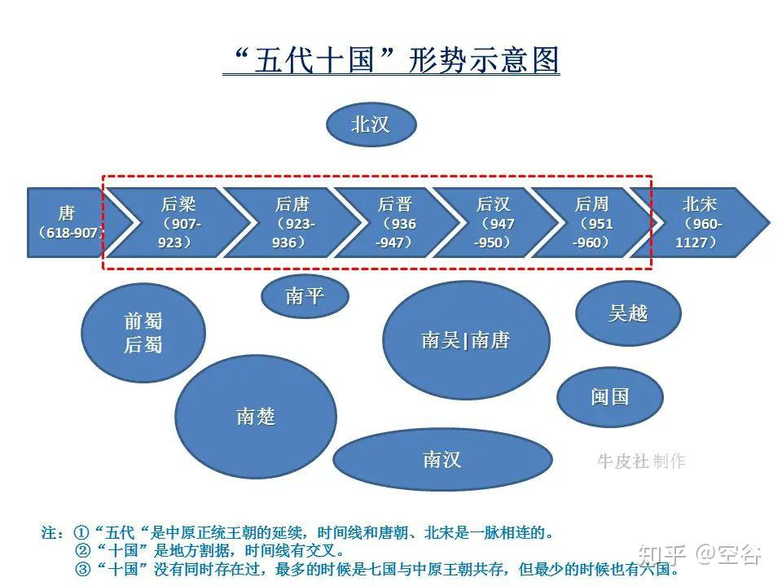
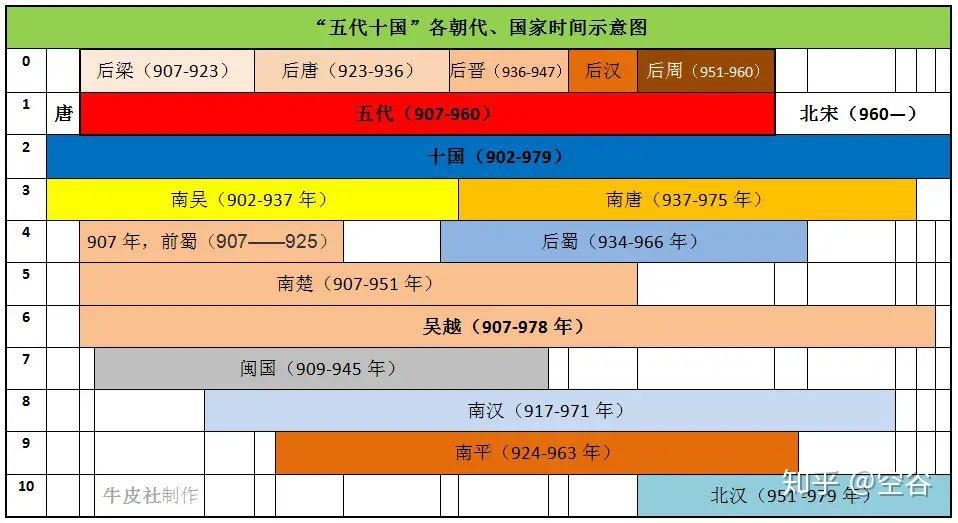

[混乱的“五代十国”，两图两表，让你轻松搞清楚](https://zhuanlan.zhihu.com/p/313061277)

## 五代

“五代”指的是定都中原地区的五个朝代，依次为：

- 后梁（907—923年）
- 后唐（923—936年）
- 后晋（936—947年）
- 后汉（947—950年）
- 后周（951—960年）

五代政权多由军阀建立，政治更迭频繁，但仍以中原为核心，形成北方政权的连续性。

## 十国

“十国”是指中原之外的割据政权，主要分布在南方及西南地区，包括：

- 前蜀、后蜀
- 南吴、南唐
- 吴越
- 闽国
- 南楚
- 南汉
- 荆南（南平）
- 北汉

这些政权大多相对独立，南方经济和社会发展较为稳定，文化艺术也有所繁荣。

“词中之帝”李煜，南唐中主李璟、冯延巳等人，在词史上都占有重要地位。

---

- 政治：北方五代更迭频繁，南方十国相对稳定，形成“北乱南治”的格局。
- 经济：经济重心南移，南方经济地位超过北方，推动宋朝“农商并重”政策。
- 文化：门阀制度瓦解，科举取士比例提高，社会流动性增强，文化艺术如《韩熙载夜宴图》反映当时社会风貌。
- 军事与制度：五代军阀割据促使宋朝建立后实行“杯酒释兵权”、设转运使收财权等制度，以加强中央集权。

五代十国时期虽为乱世，但为宋朝的统一、中央集权制度和社会变革奠定基础，体现了“分裂中孕育统一”的历史规律

年表

来自：[混乱的“五代十国”，两图两表，让你轻松搞清楚](https://zhuanlan.zhihu.com/p/313061277)

- 902年，唐朝封淮南节度使杨行密为吴王。吴国政权初具雏形，揭开了“十国”序幕，史称“南吴”或“杨吴”。
- **907年，梁王朱温篡唐称帝，国号梁，史称后梁，历史进入“五代”时期。**
- 同年九月，唐·蜀王王建在成都称帝，国号蜀，史称前蜀。
- 同年，后梁封唐武安军节度使马殷为楚王，楚国成立，史称“南楚”或“马楚”。
- 同年，朱温封钱镠为吴越王，兼任淮南节度使。吴越国成立，定都杭州。
- 909年，后梁封王审知为闽王，闽国成立。
- 917年，后梁南海王刘陟在番禺称帝，国号大越。次年11月改国号为“汉”，史称南汉。
- **923年，唐·晋王李存勖灭掉后梁，在魏州称帝，沿用“唐”为国号，史称“后唐”。**
- 924年，后梁荆南节度使高季兴受后唐封为南平王，建都荆州，史称南平或荆南。
- 925年，后唐灭前蜀。
- 934年，蜀王孟知祥在成都建国称帝，年号明德，国号蜀，史称后蜀。
- **936年，石敬瑭于太原登基称帝，国号为晋，史称后晋。并在契丹扶持下灭后唐。**
- 937年，南吴睿帝杨溥让位于权臣徐知诰，徐知诰改国号为齐。次年，徐改名李昪，改国号为唐，史称南唐。
- 945年，南唐灭闽国。
- **947年，契丹灭后晋。河东节度使北平王刘知远在太原称帝，国号为汉，史称后汉。**
- 950年，后汉隐帝为溃军所杀，后汉亡。
- **951年，郭威登上皇帝宝座，改元广顺，国号周，史称后周。**
- 同年，刘知远的弟弟，后汉河东节度使刘崇据河东称帝，仍用后汉年号，史称北汉。
- 同年，南唐灭南楚。
- **960年，赵匡胤发动陈桥兵变，篡夺后周，建立北宋。“五代”结束。**
- 963年，南平降北宋。
- 966年，北宋灭后蜀。
- 971年，北宋灭南汉。
- 975年，北宋灭南唐。
- 978年，吴越降北宋。
- 979年，北宋灭北汉，“十国”结束。

---

# 宋

宋朝是上承五代十国，下启元朝的中原王朝，分为北宋、南宋两个阶段。从建隆元年（960年）赵匡胤取代后周称帝始，至祥兴二年（1279年）被元朝攻灭止，宋朝共历18帝，享国319年。

> 重文轻武

bing摘要的皇帝表

北宋皇帝（960–1127，共 9 位）

- 太祖 赵匡胤（960–976）
- 太宗 赵炅（赵光义）（976–997）
- 真宗 赵恒（997–1022）
- 仁宗 赵祯（1022–1063）
- 英宗 赵曙（1063–1067）
- 神宗 赵顼（1067–1085）
- 哲宗 赵煦（1085–1100）
- 徽宗 赵佶（1100–1125）
- 钦宗 赵桓（1125–1127）

南宋皇帝（1127–1279，共 9 位）

- 高宗 赵构（1127–1162）
- 孝宗 赵昚（1162–1189）
- 光宗 赵惇（1189–1194）
- 宁宗 赵扩（1194–1224）
- 理宗 赵昀（1224–1264）
- 度宗 赵禥（1264–1274）
- 恭帝 赵㬎（1274–1276）
- 端宗 赵昰（1276–1278）
- 末帝（怀宗）赵昺（1278–1279）

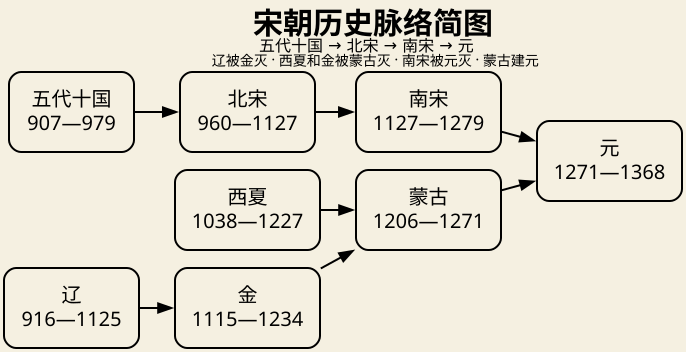

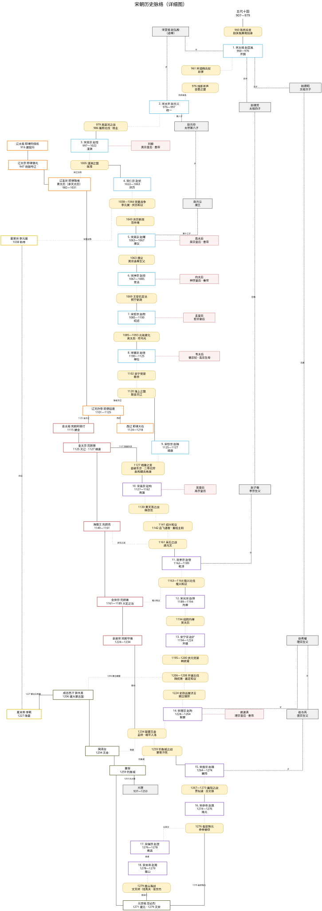

- [宋朝历史全览‌（960年—1279年）](https://zhuanlan.zhihu.com/p/26188573622)
- [宋朝皇帝世系：历经十八帝，享国319年，北宋、南宋各九位皇帝](https://zhuanlan.zhihu.com/p/2047332438863618212)

南宋：

- 经济重心南移‌：太湖流域“苏湖熟，天下足”
- ‌海洋战略‌：设市舶司（广州、泉州），海外贸易兴盛
- ‌理学官学化‌：朱熹《四书章句集注》成科举标准，重塑东亚思想体系

四大发明：

- 活字印刷‌：毕昇发明泥活字（1041年），知识传播革命
- ‌指南针‌：沈括记载磁针导航（1086年），助推大航海时代
- ‌火药武器‌：突火枪、震天雷应用于襄阳保卫战
- ‌天文历法‌：苏颂水运仪象台（1092年），最早机械钟雏形

| ‌流派‌ | ‌代表词人‌ | ‌传世名句‌                         | ‌时代烙印‌                   |
| ------ | ---------- | ---------------------------------- | ---------------------------- |
| 豪放派 | 苏轼       | “大江东去，浪淘尽，千古风流人物”   | 士大夫的家国襟怀与哲学思考   |
| 婉约派 | 李清照     | “寻寻觅觅，冷冷清清，凄凄惨惨戚戚” | 乱世个人的飘零之痛与性别觉醒 |
| 爱国词 | 辛弃疾     | “醉里挑灯看剑，梦回吹角连营”       | 南宋抗金精神的艺术升华       |

- 绘画‌：张择端《清明上河图》写实市井，范宽《溪山行旅图》造境崇高
- ‌书法‌：宋四家（苏黄米蔡）尚意书风，突破唐法
- ‌哲学‌：程朱理学（存天理灭人欲）与陆九渊心学（吾心即宇宙）分庭抗礼
- ‌史学‌：司马光《资治通鉴》通史典范，袁枢创纪事本末体

---

- 制度遗产‌：文官体系、科举制度、商业税法深刻影响明清
- ‌经济范式‌：纸币（交子）与商业契约推动近代转型
- ‌文化基因‌：士人风骨（文天祥“人生自古谁无死”）、市民文化（勾栏瓦舍）
- ‌世界影响‌：指南针促成地理大发现，宋瓷成为China代名词

印证了‌“文明存续不唯武力”‌的悖论。

---

## 北宋

960 赵匡胤称帝，以宋为国号，定都开封。

两次“杯酒释兵权”，设枢密院与三衙互相制约，推行“强干弱枝”策略，弱地方藩镇势力，以“更戍法”削弱将领对军队掌控，加强中央集权。

赵光义（太宗），976–997，完成统一，两次伐辽失败，确立“重文轻武”国策。

赵恒（真宗），与辽国数战，“澶渊之盟”，广建宫观、粉饰太平，导致社会矛盾加剧，皇后刘娥逐渐干政。

赵祯，第一次“宋夏战争”，辽国重兵压境被迫增加岁币，“庆历新政”失败。

赵曙，用韩琦、欧阳修。

赵顼，王安石变法，效果不佳，有局限性。

赵煦即位，高太后临朝听政。高太后掌权时，恢复旧法、贬逐变法官员，史称“元祐更化”。

赵佶，政治腐败，生活奢靡，农民起义不断。

赵桓，1125年金军南下，1126年破汴京，宋徽宗赵佶、宋钦宗赵桓皆被掳往北方，北宋灭亡。

---

## 南宋

宋高宗赵构：钦宗赵桓之弟，南迁称帝。

“靖康之变”爆发，都城沦陷，赵构辗转至南京应天府，于靖康二年（1127年）五月初一在应天府即皇帝位，改元建炎，史称南宋。

赵构即位后，犹豫于抵抗与求和金军威胁，用岳飞、韩世忠等抵抗金军和伪齐，任用汪伯彦、黄潜善、秦桧等与金国媾和，于绍兴十一年（1141年）与金国达成“绍兴和议”，以放弃旧疆和对金国称臣纳贡的代价，得以偏安南方，并削夺诸将兵权，冤杀岳飞等。

赵昚即位之初，锐意进取，替岳飞平反，起用张浚，发动“隆兴北伐”，试图收复中原，但却遭遇惨败，被迫与金国缔结“隆兴和议”。之后，赵昚注重内政，整顿吏治、裁汰冗官，使南宋逐渐安定发展，缔造“乾淳之治”。

赵惇（光宗），1189–1194，在位期间精神疾病加重，李后干政，朝政混乱，被迫退位。

赵扩（宁宗），1194–1224，韩侂胄、史弥远相继专权，“开禧北伐”失败，签订“嘉定和议”。

赵昀（理宗）曾立志中兴，对内“端平更化”改革，对外派兵联蒙灭金，试图收复三京，失败，蒙古侵宋。

赵昀晚年奸臣当道，国势衰微。

赵禥沉溺酒色，国势日衰，蒙军大举南下，南宋岌岌可危，“襄阳之战”。

宋恭帝赵㬎退位降元后，文天祥、陆秀夫等效仿宋高宗故事，拥立赵昰为天下兵马都元帅，图谋再次中兴。五月初一，张世杰、陆秀夫等在福州拥立赵昰即皇帝位，改元景炎。

1279，元军破南宋崖山，宋朝灭亡。

> 我觉得我没抄好。

---

# 元

1206年，铁木真统一蒙古各部，建立蒙古汗国；1271年，忽必烈改国号为元；1368年，明军攻入大都，元朝灭亡。元朝享国97年，自太祖起共15帝（含蒙古汗国时期）。

元朝是由蒙古族建立的‌首个大一统少数民族王朝‌，享国97年。其以“‌行省制度奠基、欧亚帝国联通‌”改写世界格局，开创中国史上最大版图，却在民族矛盾与生态危机中急速崩塌，成为“‌草原霸权汉化困境‌”的经典案例。

- [为什么元顺帝一般我们叫他谥号而不叫元惠宗?](https://www.zhihu.com/question/649138532/answer/3507971151)
- [元朝历史全览‌（1271年—1368年）](https://zhuanlan.zhihu.com/p/26247430938)
- [元朝历代皇帝大全](https://zhuanlan.zhihu.com/p/649383850)

皇帝表

1. **孛儿只斤·铁木真（元太祖），“成吉思汗”，大规模侵略扩张，杰出的政治家、军事家。**
2. 孛儿只斤·窝阔台（元太宗），成吉思汗三子，随父征战，完善国家制度，赋税制度。
3. 孛儿只斤·贵由（元定宗），元太宗长子，派兵征服吐蕃，控制河套地区，沉溺酒色，身体日渐虚弱，未改变“法度不一，内外离心”的日益衰腐的局面。

4. 孛儿只斤·蒙哥（元宪宗），更改政制，继续扩张，沈默寡言、不好侈靡，喜欢打猎。
5. **孛儿只斤·忽必烈（元世祖），卓越的政治家、军事家，建元，崖山海战灭宋。行省制，加强中央集权，社会经济逐渐恢复和发展。建立了幅员辽阔的统一多民族国家——元。**
6. 孛儿只斤·铁穆耳（元成宗），基本维持守成局面，但滥增赏赐，入不敷出，国库资财匮乏，钞币贬值。晚年朝政衰败。

7. 孛儿只斤·海山（元武宗），大兴土木，通货膨胀，将中书省宣敕、用人权划归尚书省。
8. 孛儿只斤·爱育黎拔力八达（元仁宗），推行忽必烈的“汉法”政策，开始实行科举考试，使民族矛盾有所缓和，可以说是元朝历代皇帝中难得一见的有为之君。
9. 孛儿只斤·硕德八剌（元英宗），继续推行“汉法”，颁布了元朝正式法典——《大元通制》，并在宰相拜住、中书省平章政事张圭等的帮助下实施了一些新政。
10. 孛儿只斤·也孙铁木儿（元泰定帝），基本保留了仁，英二朝的改革成果，局部暴乱，但整体安定。
11. 孛儿只斤·阿速吉八（天顺帝），在位1个月。

12. 孛儿只斤·图帖睦尔（元文宗），创建奎章阁，编修《经世大典》，兴文治，与拥立天顺帝的倒刺沙进行内战，崇尚佛教，走向极端。
13. 孛儿只斤·和世琜（元明宗），在位8月。

14. 孛儿只斤·懿璘质班（元宁宗），在位仅53天。

15. 孛儿只斤·妥懽帖睦尔（元顺帝/元惠宗），恢复科举，1368年，明军进攻大都，元惠宗向北撤，到达上都，后转至应昌。并两次组织元军反攻，未成，元朝灭亡。1370年5月23日，元惠宗病逝于应昌。

---

- 天文‌：四海测验设27个观测点，为《授时历》提供实测数据
- ‌医学‌：危亦林首创脊椎悬吊复位法
- ‌地理‌：《舆地图》绘南海诸岛
- ‌机械‌：王祯《农书》载水力大纺车

---

- 民族压迫‌：四等人制激化民族矛盾
- ‌通货失控‌：至正钞滥发，恶性通货膨胀
- ‌生态灾难‌：黄河改道引发饥荒
- ‌军政废弛‌：蒙古军“但以飞杯为飞炮，酒令为军令”
- ‌全球变冷‌：14世纪小冰期致漠北牧场退化，动摇统治根基

---

- 制度遗产‌：行省制沿用至今，土司制度影响西南治理
- ‌民族融合‌：回族形成，契丹、党项等族名消失融汉
- ‌技术传播‌：火药西传改写战争史，青花瓷成全球化符号
- ‌文化记忆‌：元曲列世界非遗，《马可·波罗游记》激发大航海
- ‌边疆奠基‌：西藏正式纳入中央管辖，台湾设澎湖巡检司

---

元朝印证了‌“文明征服者终被文明征服”‌的悖论。正如《元史》所叹：“元之天下，视前代所以为盛，然好生之德未洽于民。” 这个用铁骑贯通欧亚的王朝，因拒绝深度汉化而速亡，却在技术传播与制度创新中永生。

---

# 明

明朝是中国历史上最后一个由汉人建立的大一统封建王朝，建立于公元1368年，亡于公元1644年，国祚276年，传12世16帝。

皇帝表：[明朝十六位皇帝一览表](https://zhuanlan.zhihu.com/p/676016935)

> 不是懒，而是他写得太好了

- [一口气看完明朝276年历史](https://zhuanlan.zhihu.com/p/660008472)
- [明朝历史全览‌（1368年—1644年）](https://zhuanlan.zhihu.com/p/26261202031)

---

关键时间

- 1368年，朱元璋在南京应天府建元称帝，建立明朝，是为明太祖。
- 1370年，恢复科举；八股取士后来逐步定型。
- 1380年，废中书省，罢丞相。六部直接对皇帝负责，加强了皇权。
- 1388年，灭北元。
- 1402年，明惠宗火烧皇宫，朱棣登基称帝，即明成祖。
- 1403年，北平改北京，北平府改顺天府。
- 1405年，郑和出使西洋，两年后返回。
- 1408年，郑和二下西洋，两年后返回。
- 1409年，交好鞑靼失败，成祖亲征；郑和三下西洋，两年后返回。
- 1413年，郑和四下西洋，两年后返回。
- 1417年，郑和五下西洋，两年后返回。
- 1421年，迁都北京，郑和六下西洋，于次年返回。
- 1423年，鞑靼服明。
- 1431年，明宣宗派郑和七下西洋，此次大明船队最远到达东非沿岸。郑和于返航途中在古里去世。
- 1435年，衰落开始。
- 这中间有点乱，大概是与蒙古不和，军事失利，葡萄牙获澳门居住权，倭寇横行，建议看：[一口气看完明朝276年历史](https://zhuanlan.zhihu.com/p/660008472)
- 1464年，废除宫妃殉葬制度。
- 1477年，明宪宗加强特务统治，设西厂。
- 1487年，弘治中兴。
- 1513年-1517年，与葡萄牙的交流，不顺。
- 1521年，接见了葡萄牙使团，这是中国与变革中的欧洲发生的第一次官方接触。明武宗驾崩后，朝中的保守派拒绝了新来的葡萄牙使节，还与葡萄牙发生了屯门海战。
- 1523年，日本派遣了使团两个，“争贡之役”，废福建、浙江市舶司，仅留广东市舶司，断绝了与日本的贸易途径，致使倭寇滋生，为后来东南沿海地区倭寇横行埋下祸端。
- 1532年，蒙古土默特部首领俺答汗要求“通贡”，即与明朝建立贸易关系，被明世宗拒绝。
- 1542年，“壬寅宫变”。
- 1561-1565年，戚继光与俞大猷抗倭。
- 1567年，“隆庆之治”。
- 1582年，张居正去世，有为之臣，被弹劾抄家。
- 1592年，“宁夏之役”，“万历朝鲜战争”。
- 1599–1600年，“播州之役”，此为万历三大征。
- 1616年，统一了东北女真各部的努尔哈赤建立后金。
- 1618年，努尔哈赤以“七大恨”祭告天地，正式起兵反明。
- 1620年，明熹宗重用魏忠贤，魏忠贤权势滔天，排除异己，专断国政，“只知有忠贤，而不知有皇上”。
- 1628年，改革驿站制度。
- 1629年-1644年，明VS李自成（起义 闯王）&皇太极（清）。
- 1644年，李自成破北京，崇祯帝朱由检自缢于煤山，明朝灭亡。

---

| ‌制度    | ‌ ‌运作机制                | ‌ ‌历史影响                              |
| -------- | -------------------------- | ---------------------------------------- |
| 内阁制   | 翰林学士参预机务，无决策权 | 催生票拟批红体系，宦官掌批红权           |
| 厂卫系统 | 锦衣卫+东厂/西厂监察百官   | 特务政治渗透社会各阶层，诏狱成为法外之地 |
| 科举八股 | 四书五经命题，程朱理学为纲 | 塑造士大夫意识形态，但禁锢思想创新       |

- 一条鞭法‌（1581年）：赋役折银征收，推动白银货币化
- ‌开中法‌：盐引换军粮，晋商崛起
- ‌隆庆开关‌（1567年）：月港开放海贸

四大发明 Enhanced Version：

- 火药‌：三眼铳、神机营建制化火器部队
- ‌印刷‌：套色版画技术，《十竹斋笺谱》多色叠印
- ‌指南针‌：郑和航海牵星术+罗盘定位
- ‌造纸‌：竹纸工艺革新

---

经济：

- 江南丝织‌：苏州“机户出资，机工出力”资本主义萌芽
- ‌景德镇瓷器‌：青花瓷大量外销
- ‌闽粤海商‌：月港—马尼拉航线贸易兴盛
- ‌晋徽商帮‌：票号汇兑网络覆盖全国

---

| ‌领域‌   | ‌代表人物‌ ‌       | 成就‌                                    |
| -------- | ------------------ | ---------------------------------------- |
| 思想哲学 | 王阳明、李贽       | 心学打破理学桎梏，提倡“人欲即天理”       |
| 科学著作 | 宋应星《天工开物》 | 系统总结农业与手工业技术，含锌冶炼等记载 |
| 文学艺术 | 汤显祖《牡丹亭》   | 昆曲巅峰之作，以梦境叙事                 |
| 军事科技 | 戚继光“虎蹲炮”     | 后膛装弹设计，提升射速                   |

- “四大奇书”的概念形成于明末清初，是明代四部长篇章回小说《三国演义》《水浒传》《西游记》《金瓶梅》的合称。
- 四大名著是指 **《水浒传》《三国演义》《西游记》[《红楼梦》](https://baike.baidu.com/item/%E7%BA%A2%E6%A5%BC%E6%A2%A6/15311)** 四部长篇小说，作者分别是 施耐庵 、 罗贯中 、 吴承恩 、 曹雪芹。
- [《红楼梦》](https://baike.baidu.com/item/%E7%BA%A2%E6%A5%BC%E6%A2%A6/15311)，别名《石头记》，中国古代章回体长篇小说，中国古典四大名著之一。其通行本共120回，前80回为清代作家曹雪芹所著，后40回为无名氏续，整理者为程伟元、高鹗。

---

# 清

1616-1912，历12帝，享国296年（自1644年入关起为268年）。

清朝是中国历史上最后一个封建王朝，自1616年清太祖努尔哈赤建立后金，到1912年宣统帝退位。

- [清朝时期历史大事年表](https://www.gugong.net/zhongguo/qingchao/275_6.html)
- [清朝历史全览‌（1636年—1912年）](https://zhuanlan.zhihu.com/p/26266024790)
- [清朝12位皇帝列表](https://zhuanlan.zhihu.com/p/399452687)

| 序号 | 姓名              | 庙号   | 年号       | 在位时间       | 合计 |
| ---- | ----------------- | ------ | ---------- | -------------- | ---- |
| 1    | 爱新觉罗·努尔哈赤 | 清太祖 | 天命       | 1616年～1626年 | 10   |
| 2    | 爱新觉罗·皇太极   | 清太宗 | 天聪与崇德 | 1626年～1643年 | 17   |
| 3    | 爱新觉罗·福临     | 清世祖 | 顺治       | 1644年～1661年 | 17   |
| 4    | 爱新觉罗·玄烨     | 清圣祖 | 康熙       | 1661年～1722年 | 61   |
| 5    | 爱新觉罗·胤禛     | 清世宗 | 雍正       | 1722年～1735年 | 13   |
| 6    | 爱新觉罗·弘历     | 清高宗 | 乾隆       | 1736年～1796年 | 60   |
| 7    | 爱新觉罗·颙琰     | 清仁宗 | 嘉庆       | 1796年～1820年 | 24   |
| 8    | 爱新觉罗·旻宁     | 清宣宗 | 道光       | 1820年～1850年 | 30   |
| 9    | 爱新觉罗·奕詝     | 清文宗 | 咸丰       | 1851年～1861年 | 10   |
| 10   | 爱新觉罗·载淳     | 清穆宗 | 同治       | 1861年～1874年 | 13   |
| 11   | 爱新觉罗·载湉     | 清德宗 | 光绪       | 1874年～1908年 | 34   |
| 12   | 爱新觉罗·溥仪     | —      | 宣统       | 1908年～1912年 | 4    |

> 溥仪无正式庙号；“清宪宗”为逊清小朝廷私谥，教材一般称“宣统帝”或“清逊帝”。

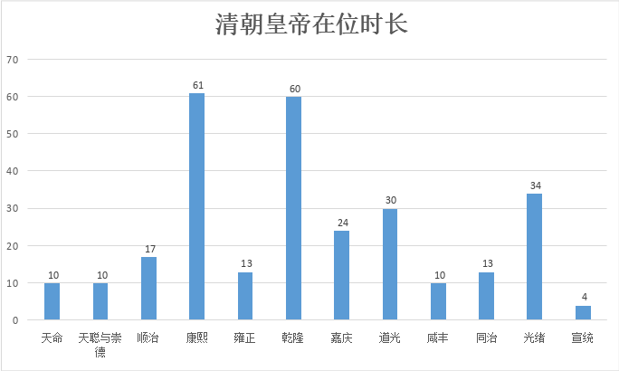

---

豆包AI总结的简史（核心事件）

**关外奠基与立国（1616–1644）**

1. **1616 努尔哈赤建立后金**
   建州女真努尔哈赤统一女真各部，在赫图阿拉称汗，国号后金，和明朝对抗；萨尔浒之战大败明军，奠定割据东北的基础。
2. **1636 皇太极称帝，改国号【大清】（清朝正式建立）**
   皇太极改族名为满洲，在沈阳称帝，国号大清，完善制度，为入主中原做准备。
3. **1644 清军入关、定都北京**
   李自成攻破北京，明朝灭亡；吴三桂引清兵入关，击败大顺军，顺治迁都北京，逐步征服全国。

**清初巩固、康乾盛世（1644–1799）**

1. **1662–1683 收复台湾**
   郑成功从荷兰手中收复台湾；1683 施琅平台湾，1684 设台湾府，纳入清朝版图。
2. **1685–1689 雅克萨之战 & 《尼布楚条约》**
   康熙反击沙俄入侵，签订 **《尼布楚条约》**，是清朝早期平等边界条约，划定中俄东段边界。
3. **1673–1681 平定三藩之乱**
   康熙平定吴三桂等南方藩王叛乱，稳定南方统治。
4. **1690–1757 平定准噶尔**
   康熙、雍正、乾隆三代持续用兵，击败准噶尔汗国，统一新疆；奠定现代中国西北疆域基础。
5. **1793 马戛尔尼使团访华**
   英国使团来华请求通商，乾隆拒绝，坚持闭关，清朝错失接轨世界的机会，盛世之下暗藏危机。

> 康雍乾时期（约 1660–1795）：**康乾盛世**，封建经济顶峰，人口大增，但闭关锁国、文字狱盛行，和西方拉开差距。

**晚清屈辱开端：鸦片战争、南京条约（近代史起点）**

1. **1840–1842 第一次鸦片战争｜1842《南京条约》**
   中国近代第一个不平等条约：割香港岛、赔款 2100 万银元、五口通商、协定关税；**中国开始沦为半殖民地半封建社会**，近代史开端。后续还有《虎门条约》《望厦条约》《黄埔条约》。

**持续动荡与第二轮边疆 / 主权大损失（1851–1864）**

1. **1851–1864 太平天国运动**
   洪秀全金田起义，定都天京（南京），是中国历史规模最大农民战争；1864 天京陷落，运动失败，清朝元气大伤。
2. **1856–1860 第二次鸦片战争｜火烧圆明园、《天津条约》《北京条约》**
   英法联军攻入北京，焚毁圆明园；《天津条约》允许公使驻京、增开通商口岸；《北京条约》割九龙司、赔款；俄国趁乱签《瑷珲条约》《北京条约》，割走东北 100 多万平方公里土地；半殖民地化程度加深。
3. **1861 辛酉政变，慈禧掌权；洋务运动开启**
   奕䜣、慈禧发动政变；洋务派开始自强求富，办军工、新式学堂，是中国第一次近代化尝试。

**边疆危机、中法战争、甲午惨败**

1. **1875–1878 左宗棠收复新疆**
   击败阿古柏；1884 设立新疆行省，巩固西北。
2. **1883–1885 中法战争、《中法新约》**
   清军局部取胜，但清廷妥协签约，放弃对越南宗主权，法国势力进入中南半岛。
3. **1894–1895 甲午中日战争｜1895《马关条约》**
   北洋水师全军覆没；割台湾、澎湖，赔款白银 2 亿两，允许列强在华设厂；刺激列强瓜分中国狂潮，半殖民地化大大加深。

**灭亡前夕：八国联军、辛丑条约、清末新政**

1. **1900 八国联军侵华｜1901《辛丑条约》**
   赔款 4.5 亿两白银（本息合计近 10 亿），划定使馆区、允许列强驻军；**清政府彻底沦为列强统治中国的工具，中国完全沦为半殖民地半封建社会**。
2. **1901–1911 清末新政、预备立宪**
   清廷自救改革，练新军、办学堂、废科举，但改革缓慢，立宪骗局加速民心丧失。

**王朝终结**

1. **1911.10.10 武昌起义（辛亥革命爆发）**
   各省纷纷独立。
2. **1912.2.12 宣统帝溥仪下诏退位**
   清朝正式灭亡，两千多年君主专制制度结束。

---

清朝作为中国‌最后一个封建王朝‌，以“‌满汉融合、开疆拓土‌”奠定现代中国版图基础，却在‌工业文明冲击‌中成为“‌古典帝国的黄昏样本‌”。

- 故宫建筑群‌：现存最大木质宫殿建筑
- 《四库全书》：收录3461种古籍，毁书与存书并举
- ‌京剧艺术‌：2010年入选人类非遗
- ‌颐和园‌：皇家园林集大成者
- 《红楼梦》：封建社会的百科全书

> [!References]
>
> [1] 《中英天津条约》[EB/OL]. [2026-11-20]. <https://www.dpm.org.cn/lemmas/241732.html>.
>
> [2] 《中英北京条约》[EB/OL]. [2026-11-20]. <https://www.dpm.org.cn/lemmas/241740.html>.
>
> [3] 中俄尼布楚条约[EB/OL]. [2026-11-20]. <https://www.dpm.org.cn/lemmas/241561.html>.
>
> [4] 《中俄瑷珲条约》[EB/OL]. [2026-11-20]. <https://www.dpm.org.cn/lemmas/241746.html>.
>
> [5] 《辛丑条约》——1901年9月7日[EB/OL]. [2026-11-20]. <http://jds.cssn.cn/xscg/xslw/201605/t20160506_5249750.shtml>.
>
> [6] 《望厦条约》[EB/OL]. [2026-11-20]. <https://www.dpm.org.cn/lemmas/241866.html>.
>
> [7] （三）《中法会订越南条约》 | 中国文化研究院 - 灿烂的中国文明[EB/OL]. [2026-11-20]. <https://chiculture.org.hk/sc/photo-story/1446>.
>
> [8] 《南京条约》[EB/OL]. [2026-11-20]. <https://www.dpm.org.cn/lemmas/241863.html>.
>
> [9] 马关条约[EB/OL]. [2026-11-20]. <https://www.mfa.gov.cn/diaoyudao/chn/flfg/gjty/201510/t20151009_8560614.htm>.
>
> [10] 《黄埔条约》[EB/OL]. [2026-11-20]. <https://www.dpm.org.cn/lemmas/241864.html>.
>
> [11] 《虎门条约》——1843年10月8日[EB/OL]. [2026-11-20]. <http://jds.cssn.cn/xscg/xslw/201605/t20160506_5249718.shtml>.

---

# 中华民国

民国这一历史时期，始于1912年，终于1949年，总共跨越了38个年头。它是中国历史上的一个重要阶段，见证了众多的变革与纷争。

- [民国从哪年开始到哪年结束？其中经历了那些历史时期？](https://zhuanlan.zhihu.com/p/693997300)

- [中华民国是一种怎样的存在？](https://zhuanlan.zhihu.com/p/21665178)

## 临时政府

1912年1月1日——1912年4月2日

1911年，辛亥革命爆发，清王朝的统治被推翻。武昌新军中的革命党人于1911年10月10日起义，一举攻占总督衙门，并迅速光复汉口和汉阳。

1912年元旦，中华民国临时政府在南京成立，孙中山任临时大总统。中华民国开始从清朝的封建统治中解脱出来，向现代化的方向迈进。

## 北洋政府

1912年4月26日——1928年6月

1912年4月，袁世凯在北京就任中华民国临时大总统，后于1913年镇压二次革命，同年当选为首任中华民国大总统，北洋政府正式形成。“袁世凯窃取革命果实”。

1913年3月，宋教仁遇刺；孙中山号召武力讨袁，发动“二次革命”，被袁世凯镇压。袁世凯复辟帝制，护国运动爆发，被迫取消帝制。

俄国十月社会主义革命胜利后，李大钊和陈独秀在中国宣传共产主义。1919年爆发了五四运动，马克思主义在中国传播开来，成为新思潮的主流。1921年中国共产党诞生了。

## 国民政府

1928年6月——1949年

### 南京国民政府

**1925年3月孙中山逝世后，国民党右派加紧争夺革命领导权。** 1927年4月，蒋介石在上海发动了“四一二”反革命政变；1927年7月15日，汪精卫在武汉发动“七一五”反革命政变，第一次国共合作破裂。这期间，以陈独秀为代表的中共中央犯了右倾投降主义错误。

1928年6月，国民政府开始在形式上统一中国，蒋介石成为国民政府主席。内战、外患。

### 抗日战争

> 14年抗战

1931年，日本发动九一八事变，从东北地区开始侵华。抗日战争开始。

抗战初期，国民政府——国民党军队在**正面战场**组织多次大规模战役，抗击日本侵略者，但实行的是一条**片面抗战**的路线，丧失了大片国土。

中国共产党实行的是**全面抗战路线**，执行持久抗战的方针。八路军、新四军深入敌后，建立抗日根据地，开辟**敌后战场**。

1945年中国人民取得了抗日战争的胜利。

### 解放战争

1946年1月政治协商会议在重庆召开。1946年5月，国共谈判在南京举行。蒋介石借口共产党拒绝从苏北、皖北等地撤退，公然调集二十万军队，于6月大举围攻以宣化店为中心的中原解放区，发动了全面内战。

此后，国共之间经历了三大战役：辽沈战役，[淮海战役](http://www.mod.gov.cn/gfbw/gfjy_index/js_214151/4834146.html)，平津战役，解放军全都战胜了国民党军队。

辽沈战役

是解放战争时期，中国人民解放军东北野战军及东北军区部队，于1948年9月12日至11月2日，在辽西及沈阳、长春地区同国民党军进行的战略决战。

平津战役

是解放战争战略决战阶段三大战役中的最后一役，也是关键一役，由东北野战军、华北军区部队和地方部队百万余人，在东起唐山、西至张家口的500余公里战线上，对国民党军傅作义集团进行的战略性决战，发生于1948年11月29日至1949年1月31日。

1949年4月21日， 毛主席和朱德总司令发布命令，百万雄师强渡长江， 摧毁了国民党军的防线，于23日解放南京。

1949年10月1日中华人民共和国成立，标志着民国时代的结束。中国人民迎来了新的生活和希望。

---

尽管民国时期充满了动荡和变革，但它也是中国历史上一个充满活力和希望的时期。在这个时期，中国的经济、文化和社会都得到了前所未有的发展。工业、商业、教育、文化等各个领域都取得了显著的进步。

同时，民国时期也是中国近代文化的发源地，涌现出了许多杰出的文学家、艺术家和思想家。所以，尽管民国时期充满了动荡和变革，但它仍然是中国历史上一个重要而宝贵的阶段。

---

题外话，我在查资料的时候，知乎用户[蝉羽十三](https://www.zhihu.com/people/wongan-kinlo)，出现多次，且文体结构固定，更新时间高度集中，关于历史的文章封面特点明显（或为AI图）。文章也或为AI生成，但有参考价值，我有些担忧。另外，文中有很多古代“数据”，请注意甄别其真伪性。此人在25年2月24-26活跃后，目前（2026-11-20）尚无新内容。

---

# 参考文献

- [1] 建安七子[M/OL]//百度百科. [2026-07-29](2026-11-19). <https://baike.baidu.com/item/%E5%BB%BA%E5%AE%89%E4%B8%83%E5%AD%90/66612>.
- [2] 周平王 \_ 百科[EB/OL]. [2026-11-19]. <https://baike.weixin.qq.com/v10008650489.htm>.
- [3] 《中英天津条约》[EB/OL]. [2026-11-20]. <https://www.dpm.org.cn/lemmas/241732.html>.
- [4] 《中英北京条约》[EB/OL]. [2026-11-20]. <https://www.dpm.org.cn/lemmas/241740.html>.
- [5] 中国历史朝代歌（完整） - 立伟 - 博客园[EB/OL]. [2026-11-19]. <https://www.cnblogs.com/wei2yi/archive/2011/10/12/2208184.html>.
- [6] 中俄尼布楚条约[EB/OL]. [2026-11-20]. <https://www.dpm.org.cn/lemmas/241561.html>.
- [7] 《中俄瑷珲条约》[EB/OL]. [2026-11-20]. <https://www.dpm.org.cn/lemmas/241746.html>.
- [8] 《辛丑条约》——1901年9月7日[EB/OL]. [2026-11-20]. <http://jds.cssn.cn/xscg/xslw/201605/t20160506_5249750.shtml>.
- [9] 《望厦条约》[EB/OL]. [2026-11-20]. <https://www.dpm.org.cn/lemmas/241866.html>.
- [10] 数典忘祖（出自《左传》的汉语成语）\_百度百科[EB/OL]. <https://baike.baidu.com/item/%E6%95%B0%E5%85%B8%E5%BF%98%E7%A5%96/2022670>.
- [11] （三）《中法会订越南条约》 | 中国文化研究院 - 灿烂的中国文明[EB/OL]. [2026-11-20]. <https://chiculture.org.hk/sc/photo-story/1446>.
- [12] 清朝时期历史大事年表 - 古宫历史网[EB/OL]. [2026-11-20]. <https://www.gugong.net/zhongguo/qingchao/275.html>.
- [13] 《南京条约》[EB/OL]. [2026-11-20]. <https://www.dpm.org.cn/lemmas/241863.html>.
- [14] 马关条约[EB/OL]. [2026-11-20]. <https://www.mfa.gov.cn/diaoyudao/chn/flfg/gjty/201510/t20151009_8560614.htm>.
- [15] 《黄埔条约》[EB/OL]. [2026-11-20]. <https://www.dpm.org.cn/lemmas/241864.html>.
- [16] 淮海战役：以60万战胜80万的战争奇迹 - 中华人民共和国国防部[EB/OL]. [2026-11-20]. <http://www.mod.gov.cn/gfbw/gfjy_index/js_214151/4834146.html>.
- [17] 《虎门条约》——1843年10月8日[EB/OL]. [2026-11-20]. <http://jds.cssn.cn/xscg/xslw/201605/t20160506_5249718.shtml>.
- [18] 红楼梦（清代作家曹雪芹所著小说）\_百度百科[EB/OL]. [2026-11-20]. <https://baike.baidu.com/item/%E7%BA%A2%E6%A5%BC%E6%A2%A6/15311>.
- [19] 暗渡陈仓的意思\_成语暗渡陈仓的解释[EB/OL]. [2026-11-19]. <https://www.hanyuguoxue.com/chengyu/ci-8451fb7e3>.
- [20] 自由裁量击穿一切. 汉朝皇帝年表[EB/OL]. [2025-03-17](2026-11-19). <https://zhuanlan.zhihu.com/p/30898138651>.
- [21] 知乎用户KVCAX4. 清朝12位皇帝列表[EB/OL]. [2021-08-13](2026-11-20). <https://zhuanlan.zhihu.com/p/399452687>.
- [22] 知乎用户11347. 一口气了解周朝[EB/OL]. [2024-10-30](2026-11-19). <https://zhuanlan.zhihu.com/p/4032534507>.
- [23] 一粒贸易. 简述历史-商朝[EB/OL]. [2021-07-08](2026-11-19). <https://zhuanlan.zhihu.com/p/387947063>.
- [24] 泱泱. 民国从哪年开始到哪年结束？其中经历了那些历史时期？[EB/OL]. [2024-04-23](2026-11-20). <https://zhuanlan.zhihu.com/p/693997300>.
- [25] 雁素鱼筏. 夏朝（中国历史朝代）[EB/OL]. [2022-09-29](2026-11-19). <https://zhuanlan.zhihu.com/p/569482421>.
- [26] 幸有我来山未孤. 明朝十六位皇帝一览表[EB/OL]. [2024-01-04](2026-11-20). <https://zhuanlan.zhihu.com/p/676016935>.
- [27] 小满有盈. 一口气读懂魏晋南北朝，重点都列好了[EB/OL]. [2024-01-17](2026-11-19). <https://zhuanlan.zhihu.com/p/678299686>.
- [28] 香茗史馆. 宋朝皇帝世系：历经十八帝，享国319年，北宋、南宋各九位皇帝[EB/OL]. [2026-06-08](2026-11-19). <https://zhuanlan.zhihu.com/p/2047332438863618212>.
- [29] 桃源梦外客. 唐朝历史简介及历代帝王全览，共传21帝，享国289年！[EB/OL]. [2025-04-02](2026-11-19). <https://zhuanlan.zhihu.com/p/1888956760963921472>.
- [30] 汽车不限速. 混乱的“五代十国”，两图两表，让你轻松搞清楚[EB/OL]. [2020-11-26](2026-11-19). <https://zhuanlan.zhihu.com/p/313061277>.
- [31] 立早一二. 秦朝：大一统帝国的崛起与落幕[EB/OL]. [2025-03-08](2026-11-19). <https://zhuanlan.zhihu.com/p/28752214852>.
- [32] 历史地理探索. 隋唐简史，几十分钟时间了解隋唐[EB/OL]. [2025-10-09](2026-11-19). <https://zhuanlan.zhihu.com/p/1959419578837898076>.
- [33] 李.莱昂纳多. 为什么元顺帝一般我们叫他谥号而不叫元惠宗?[EB/OL]. [2024-05-23](2026-11-20). <https://www.zhihu.com/question/649138532/answer/3507971151>.
- [34] 一口气看完三国历史[Z/OL]. [2026-04-07](2026-11-19). <https://www.bilibili.com/video/BV1WqXrB9EK8/>.
- [35] 江湖术士. 中国简史——三皇五帝[EB/OL]. [2022-07-07](2026-11-19). <https://zhuanlan.zhihu.com/p/538553638>.
- [36] 华哒哒. 汉朝历代皇帝：共29位皇帝[开国皇帝为汉太祖刘邦](EB/OL). [2023-07-25](2026-11-19). <https://zhuanlan.zhihu.com/p/645787271>.
- [37] 风流龙王讲历史. 11分钟看完夏朝历史[Z/OL]. [2026-11-10](2026-11-19). <https://www.bilibili.com/video/BV1oKWM6CECJ/>.
- [38] 风尘讲历史. 一口气看完明朝276年历史[EB/OL]. [2023-10-08](2026-11-20). <https://zhuanlan.zhihu.com/p/660008472>.
- [39] 达尔文不进化. 中华民国是一种怎样的存在？[EB/OL]. [2016-07-21](2026-11-20). <https://zhuanlan.zhihu.com/p/21665178>.
- [40] 蝉羽十三. 元朝历史全览‌（1271年—1368年）[EB/OL]. [2025-02-25](2026-11-20). <https://zhuanlan.zhihu.com/p/26247430938>.
- [41] 蝉羽十三. 宋朝历史全览‌（960年—1279年）[EB/OL]. [2025-02-25](2026-11-19). <https://zhuanlan.zhihu.com/p/26188573622>.
- [42] 蝉羽十三. 清朝历史全览‌（1636年—1912年）[EB/OL]. [2025-02-25](2026-11-20). <https://zhuanlan.zhihu.com/p/26266024790>.
- [43] 蝉羽十三. 明朝历史全览‌（1368年—1644年）[EB/OL]. [2025-02-25](2026-11-20). <https://zhuanlan.zhihu.com/p/26261202031>.
- [44] 蝉羽十三. 汉朝历史全景：从布衣天子到豪强末世（前202年-220年）[EB/OL]. [2025-02-25](2026-11-19). <https://zhuanlan.zhihu.com/p/26159540447>.
- [45] 北镇抚司. 秦朝时期历史事件大全[EB/OL]. [2023-08-12](2026-11-19). <https://zhuanlan.zhihu.com/p/649547760>.
- [46] 北镇抚司. 汉朝时期历史事件大全[EB/OL]. [2023-08-12](2026-11-19). <https://zhuanlan.zhihu.com/p/649547814>.
- [47] 北镇抚司. 元朝历代皇帝大全[EB/OL]. [2023-08-11](2026-11-20). <https://zhuanlan.zhihu.com/p/649383850>.

---

**附件：**

1. [周.dot](assets/zhou.dot)
2. [汉.dot](assets/han.dot)
3. [宋.dot](assets/song.dot)
4. [宋-简.dot](assets/song-simple.dot)
