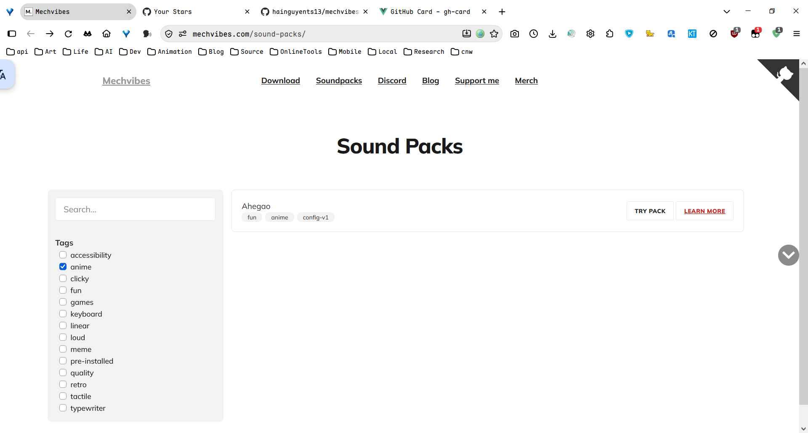
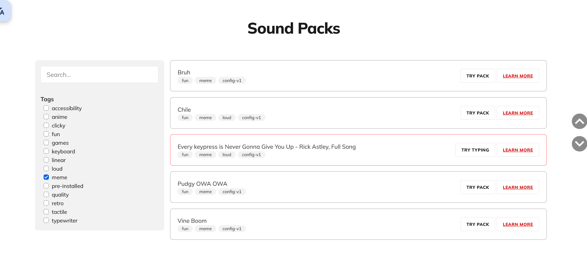
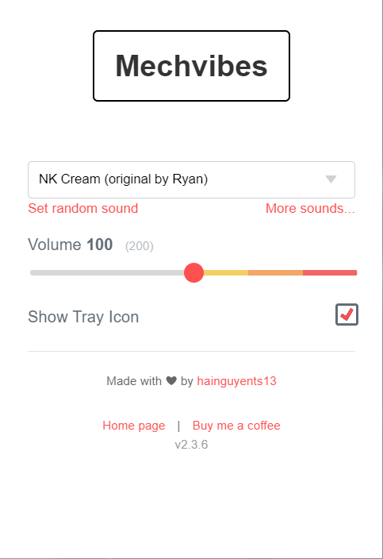
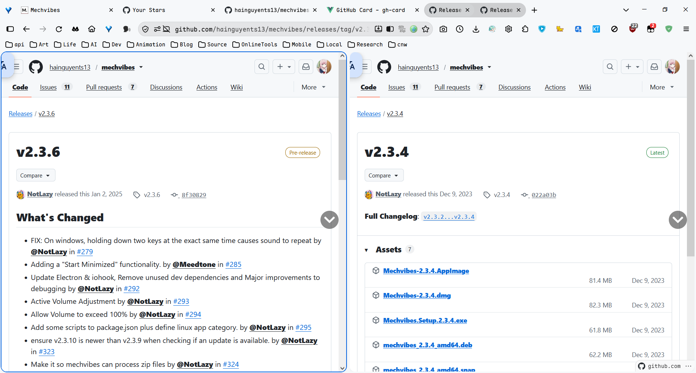
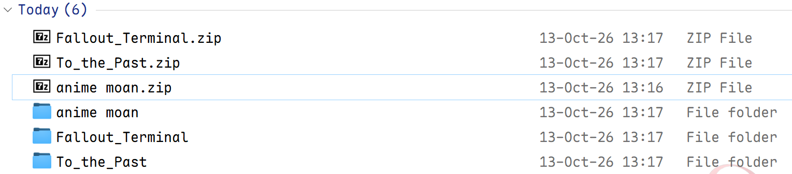
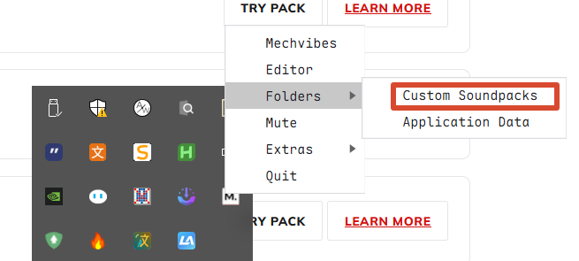

## 前言

我认为这一篇大抵是没有必要写的，但是考虑到我的愚蠢，下次可能就不会配置了，那我就必须记录一下，供自己日后查找。

首先必须确认的点是：

- 这个软件它不吃压缩包，即文件必须解压
- 软件似乎可以有多个配置位置，但是这里选已验证可用的位置
- 音效包可以在官网下载，也可以用一些大佬发布的，这个得自行查找和验证
- Mechvibes 已经停更，但是出了一个rust重写的版本，目前还在测试版本阶段
- 软件会收集用户信息，请禁用其网络权限，无网络也能正常工作：<https://mechvibes.com/blog/debug-data-retention-policy/>
- 有能力的可以考虑使用`editor`功能自己制作一个音效包

---

## 链接

<!-- 链接 -->

<https://mechvibes.com/sound-packs/>

[](https://github.com/hainguyents13/mechvibes)

[](https://github.com/hainguyents13/mechvibes-dx)

---

## 音效包

可以在<https://mechvibes.com/sound-packs/>下载想要的音效包，也可以在线试听。dx版目前还没有音效市场

比如这个音效包，就很`猎奇`，至于怎么个~，就请自己体验：



这几个也非常有趣，但是我**非常不建议**使用`Every keypress is Never Gonna Give You Up - Rick Astley, Full Song`



---

## 主界面

值得注意的是，Mechvibes已经在主界面上提供了多个相关链接，合理使用！



---

## 下载

<https://github.com/hainguyents13/mechvibes/releases>

一般情况下，我会推荐下载稳定版本，但考虑到2.3.6确实相比2.3.4有较多的不同（实际上可能只是修了两个bug，也可能并没有遵循x.y.z规则），我个人推荐下载.6版本。



---

## 配置

请直接点击下载而不是安装，安装选项似乎是没有效果的



在托盘菜单中点击自定义音效包，会打开一个文件夹，把**解压的文件夹**放到这里，重启程序即看到新的音效包。



<details>
<summary>structure</summary>

```bash
❮cmd❯  …\Roaming\Mechvibes\custom
の dir
 Volume in drive C is C
 Volume Serial Number is BE3D-3646

 Directory of C:\Users\user\AppData\Roaming\Mechvibes\custom

13-Oct-26  13:31    <DIR>          .
13-Oct-26  13:31    <DIR>          ..
11-Oct-26  19:22    <DIR>          Ahegao
13-Oct-26  13:31    <DIR>          anime moan
13-Oct-26  13:31    <DIR>          Fallout_Terminal
11-Oct-26  19:26    <DIR>          osu_lazer_keyboard
13-Oct-26  13:31    <DIR>          To_the_Past
               0 File(s)              0 bytes
               7 Dir(s)  69,430,104,064 bytes free


❮cmd❯  …\Roaming\Mechvibes\custom
の tree /f
Folder PATH listing for volume C
Volume serial number is BE3D-3646
C:.
├───Ahegao
│       Ahha.mp3
│       akagisenpai.mp3
│       animemoan.mp3
│       araara.mp3
│       aramilf.mp3
│       clapclap.mp3
│       config.json
│       dissapointonichan.mp3
│       emolga.mp3
│       evilgig.mp3
│       ganbate.mp3
│       hentai.mp3
│       huff.mp3
│       itai.mp3
│       kimochi healed.mp3
│       kimochi.mp3
│       moan.mp3
│       moan2.mp3
│       no.mp3
│       nya1.mp3
│       nya2.mp3
│       onichan.mp3
│       poi.mp3
│       rem.mp3
│       remsquirt.mp3
│       senpai.mp3
│       squeaky moan.mp3
│       tickleonichan.mp3
│       tomeito1.mp3
│       tomeito2.mp3
│       tuturu.mp3
│       wow.mp3
│       yamete.mp3
│
├───anime moan
│       1.wav
│       2.wav
│       config.json
│
├───Fallout_Terminal
│       01.wav
│       02.wav
│       03.wav
│       04.wav
│       05.wav
│       06.wav
│       charenter_01.wav
│       charenter_02.wav
│       charenter_03.wav
│       config.json
│
├───osu_lazer_keyboard
│       config.json
│       deselect.wav
│       key-caps.mp3
│       key-confirm.mp3
│       key-delete.mp3
│       key-movement.mp3
│       key-press-1.mp3
│       key-press-2.mp3
│       key-press-3.mp3
│       key-press-4.mp3
│
└───To_the_Past
        config.json
        LTTP_Text_Done.wav
        LTTP_Text_Letter.wav
```

</details>

## OSU! 音效效果

<https://www.bilibili.com/video/BV1MHTq6uEVD/>

<div style="width: 100%; aspect-ratio: 16 / 9; overflow: hidden;">
<video width="100%" controls src="assets/2026-10-13_13-40-23.mp4" title="Title"></video>
</div>
