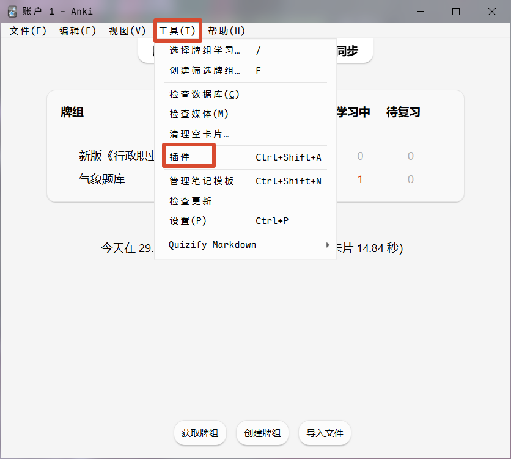
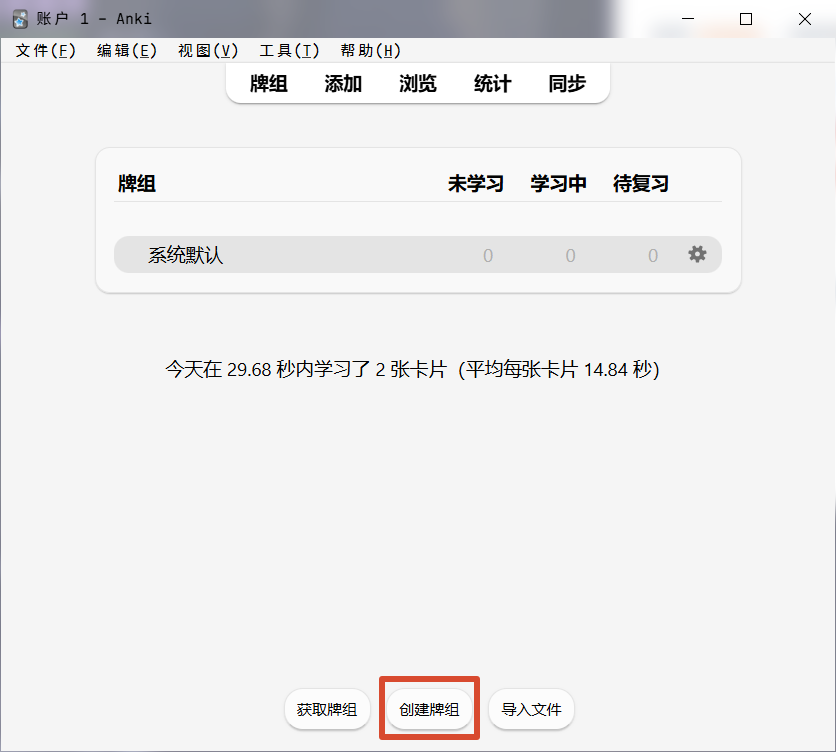
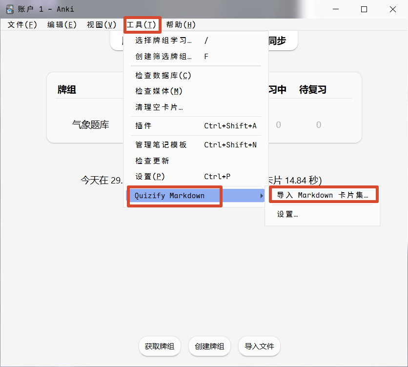
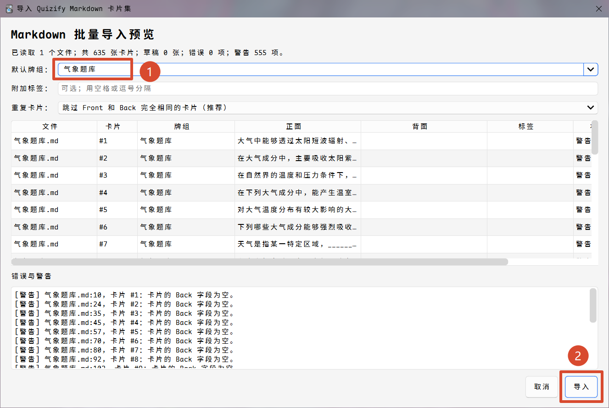
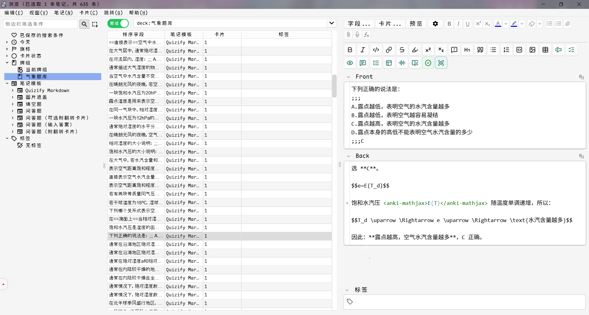
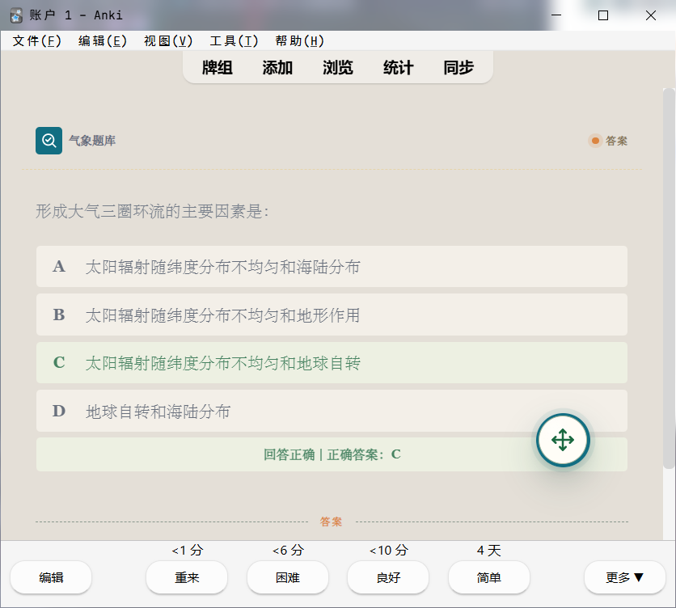

## Anki


<https://apps.ankiweb.net/>

下载一个支持插件的桌面版。

---

## e-chehil/anki-quizify


<https://github.com/e-chehil/anki-quizify#anki-quizify>

按照仓库的文档指引下载插件。

你应当得到一个`quizify_markdown.ankiaddon`文件。

---

## 装插件

打开anki



选择`本地安装`，选取刚刚下载的`quizify_markdown.ankiaddon`文件。


关闭这个界面，回到主界面。

---

## 导入题库

点击`创建牌组`：



名字随意，不过为了日后分辨，建议为`气象题库`：


导入题库：



题库在这里[下载](assets/code.zip)，解压到一个目录，然后选择`气象题库.md`导入。

<details>
<summary>压缩包内容</summary>

```shell
│   气象题库.md             # 主题库文件
│
└───assets                  # 附件资源
        b.svg
        image-1.png
        image-2.png
        image-3.png
        image.png
        wind.svg
```

</details>

选择刚刚新建的题库，点击`导入`：


---

## 查看题库

在主页点击`浏览`，即可查看题库状态：



题库预览：



---

## 特别感谢

- [ankitects/anki](https://github.com/ankitects/anki) 提供了anki软件支持
- [e-chehil/anki-quizify](https://github.com/e-chehil/anki-quizify) 让 Anki 支持 Markdown 题库导入，使题库制作和学习方式更灵活。
- VsCode 提供的编码环境

---

以及过去不那么懒惰的我自己，当时我还分享了一个VSCode工作区模板在GitHub上，如果你也想自己制作一个题库，不妨看看我的这个项目：[anki-quizify-workspace-template](https://github.com/PfolgCodeDump/anki-quizify-workspace-template)
