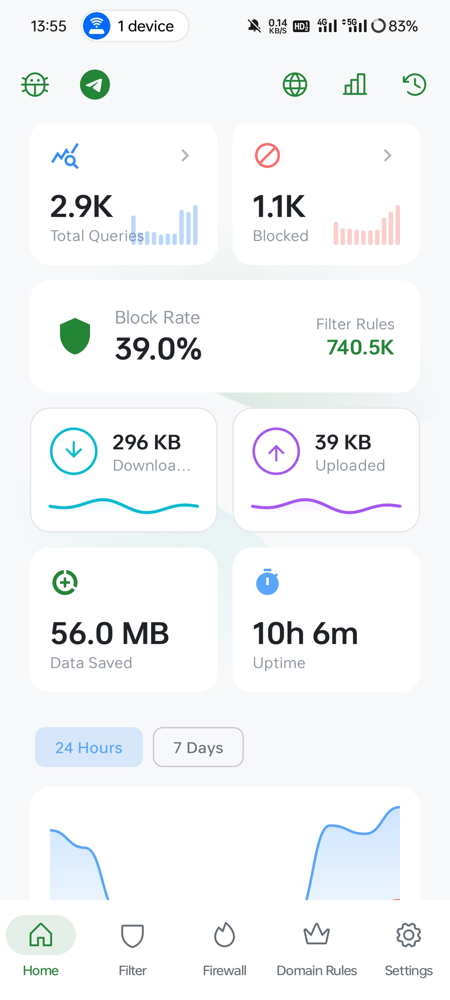

> _Cover from: Fukuro袋子(P站 ID:4588267) [TreapGoGo/deepseek-whale-girl #46](https://github.com/TreapGoGo/deepseek-whale-girl/issues/46)_

## 什么是DNS软件？

这是我自己杜撰的一个名称，指这些软件都具有在DNS层面上拦截内容的能力。

这类软件并没有一个全球统一的官方学名，根据它们共同的工作原理——在设备本地建立一个虚拟VPN通道，用于在DNS层面过滤广告和追踪器。--By DS4f

## AdGuard

我的评价：6/10

付费软件，闭源，文档开源在GitHub上，有几种不同的定价，月订阅，年？（不确定）还有终身，过节会打折，如万圣节终身版就是7折，被背刺惨了。

免费有限制，不妨碍基本使用，可自行订阅开源社区的一些拦截规则。

臃肿，看门狗功能形同虚设，没有常驻后台能力，权限给满了也没用。

支持团队很不错，反馈有求必应（我只反馈了一次）。

但它是付费的，这是优点，意味着他们会持续打磨产品，推陈出新。

但依然不如一些开源选项。

## RethinkDNS

我的评价：7/10

开源免费，可以在GitHub/F-Droid上找到。

有后台能力？有其他开源软件的offer，注意不必下载。

它是把DNS服务器放在云上，规则解析通过云，本地不托管规则，似乎也可以设置为离线模式，不支持自订阅规则，内置了许多社区规则，选择性启用，有防火墙（IP/APP）。

由于它的服务是在国外，国内用不了，规则也无法下载。所以这里不推荐服务受限的用户使用，但不受影响的地区仍算最优选择。

浅尝辄止。

## personalDNSfilter

我的评价：5/10

界面简洁，无引导，极客向，门槛高，无中文。

就只是个过滤器？！

似乎很强，但我不会，也不想投入时间成本。

浅尝辄止。

## BlockAds

我的评价：8/10

AdGuard的开源上位替代。

本地DNS滤网，支持自订阅，有防火墙（IP/APP），有超棒的后台能力。

规则命中统计、详细过滤数据

想体验~~AdGuard有后台和极速版~~的可以来。



---

## 总结

| 维度             | **AdGuard**                                                | **RethinkDNS**                                                                                                      | **personalDNSfilter**                                                                                             | **BlockAds**                                                                                                                                      |
| ---------------- | ---------------------------------------------------------- | ------------------------------------------------------------------------------------------------------------------- | ----------------------------------------------------------------------------------------------------------------- | ------------------------------------------------------------------------------------------------------------------------------------------------- |
| **价格**         | 付费，Personal 3 设备约 **\$29.88/年** 或 **\$79.99 终身** | 完全免费                                                                                                            | 免费                                                                                                              | **100% 免费**，无内购无广告                                                                                                                       |
| **开源**         | 闭源（部分文档开源）                                       | **开源**，Apache 2.0 [celzero/rethink-app](https://github.com/celzero/rethink-app) 5.8K                             | **开源**，GPL-2.0，F-Droid 可获取 [IngoZenz/personaldnsfilter](https://github.com/IngoZenz/personaldnsfilter) 952 | **开源**，GPL-3.0，F-Droid / GitHub 可获取 [pass-with-high-score/blockads-android](https://github.com/pass-with-high-score/blockads-android) 2.6K |
| **核心机制**     | 本地 VPN，系统级过滤                                       | 本地 VPN + 云端/本地规则，混合模式                                                                                  | 本地 DNS 代理，过滤**完全在本地完成**                                                                             | 本地 VPN DNS 过滤，数据 **100% 留在设备**                                                                                                         |
| **规则与订阅**   | 支持自订阅社区规则，规则生态成熟                           | 内置 **190+** 社区规则列表；**支持本地/离线规则**（OISD、StevenBlack、HaGeZi 等直接下载到设备）；但国内下载可能受阻 | 支持导入**本地 hosts 文件**或自行粘贴链接；可完全离线                                                             | **支持自订阅**（通过 URL 添加 AdGuard、EasyList 等）；内置多套规则；**定时自动更新**（6h/12h/24h/48h 可选）                                       |
| **后台与自启**   | **看门狗形同虚设**，无可靠常驻后台能力                     | 系统级“始终开启 VPN”可保活；有开机自启选项                                                                          | 支持开机自启；需配合系统“始终开启 VPN”和关闭电池优化                                                              | **明确支持“开机自动重连”**；后台 VPN profile 会保持启用                                                                                           |
| **防火墙**       | 无独立防火墙                                               | **强**：逐应用控制 Wi-Fi/移动数据，可按 IP/端口/域名规则，支持锁屏断网                                              | 无独立防火墙                                                                                                      | 支持逐应用绕过 VPN（相当于反向放行）                                                                                                              |
| **隐私与本地化** | 本地过滤，但闭源无法审计                                   | 开源可审计；**本地规则可实现零云端依赖**（取决于你的配置）                                                          | **完全本地，不“打电话回家”**，隐私最彻底                                                                          | 开源可审计；**100% 本地**，无数据采集                                                                                                             |
| **易用性**       | **界面成熟，开箱即用**                                     | 功能极多，设置项丰富，有一定学习成本                                                                                | **极客向，无中文，门槛高**                                                                                        | **界面现代**（Material 3），引导完善，中文支持，上手友好                                                                                          |
| **评价**         | “被背刺惨了…臃肿…后台能力不行…但支持不错”                  | “国内用不了…浅尝辄止”                                                                                               | “极客向…不会，也不想投入时间成本”                                                                                 | **“AdGuard 的开源上位替代”**                                                                                                                      |

> 需要注意的是，这些软件都需要高权限和忽略电池优化

---

最后分享一下自己常用的几个社区过滤器：

1. AdBlock DNS
	```
	https://raw.githubusercontent.com/217heidai/adblockfilters/main/rules/adblockdns.txt
	```
1. AdBlock Filter
    ```
	https://raw.githubusercontent.com/217heidai/adblockfilters/main/rules/adblockfilters.txt
	```

1. NEO DEV HOST
    ```
	https://raw.githubusercontent.com/neodevpro/neodevhost/master/adblocker
	```

1. anti-AD for AdGuard
    ```
	https://raw.githubusercontent.com/privacy-protection-tools/anti-AD/master/anti-ad-adguard.txt
	```

---

所以，我的选择是`BlockAds`，那么你呢？评论区聊聊吧！
